<p align="center">
  <h1 align="center">claude-whitebox</h1>
  <p align="center">
    Un framework complet de tests d'intrusion pour Claude Code — 15 agents, 6 coordinateurs de skills, 63 catégories d'attaques.
    <br />
    Structuré, avec intervention humaine (human-in-the-loop), guidé par les preuves.
  </p>
  <p align="center">
    <a href="https://github.com/LyesH4ck/claude-whitebox/blob/main/LICENSE">
      
    </a>
    <a href="https://github.com/LyesH4ck/claude-whitebox/stargazers">
      
    </a>
    <a href="https://github.com/LyesH4ck/claude-whitebox/network/members">
      
    </a>
    <a href="https://github.com/LyesH4ck/claude-whitebox/issues">
      
    </a>
    
    
    
    
  </p>
  <p align="center">
    <strong>Language / 语言 / Langue</strong>
    <br />
    <a href="README.md">English</a> | <a href="README.zh-CN.md">简体中文</a> | <a href="README.fr.md"><strong>Français</strong></a>
  </p>
</p>

---

> **Réservé aux tests de sécurité autorisés.** Obtenez toujours une autorisation écrite avant de tester un système qui ne vous appartient pas.

---

## Qu'est-ce que c'est

`claude-whitebox` est un marketplace de plugins Claude Code pour les tests de sécurité autorisés, regroupant **`pentest`** (test d'intrusion black-box) et **`codeaudit`** (audit de code source white-box) — voir [INSTALL.md](INSTALL.md).

Le plugin **`pentest`** dote Claude de capacités structurées de tests d'intrusion. Ce n'est ni un script ni un scanner — c'est un **framework de coordination d'agents** : la commande `/pentest:pentest` coordonne l'engagement depuis la session principale — elle effectue la reconnaissance, demande un plan de déploiement à un agent planificateur, puis déploie en parallèle des agents exécuteurs spécialisés (chacun suivant un workflow strict en 4 phases), consacre le budget temps à l'escalade, et exige l'approbation de l'opérateur avant toute exploitation active. Chaque découverte est accompagnée d'un PoC fonctionnel, de preuves HTTP capturées et d'une capture d'écran Playwright.

**Principes clés :**
- Intervention humaine à chaque point d'escalade — Claude ne peut pas passer à l'exploitation sans votre confirmation
- La preuve d'abord — pas de découvertes théoriques, uniquement des PoC vérifiés avec `poc.py` et `poc_output.txt`
- Sorties structurées — chaque engagement écrit du JSON lisible par machine + une analyse markdown dans `outputs/{engagement}/`
- Étendue — 11 domaines d'attaque, 63 sous-catégories, 25+ outils de sécurité référencés

---

## Installation

Ajoutez d'abord le Marketplace
```bash
# Ajoutez le marketplace depuis Claude Code
/plugin marketplace add LyesH4ck/claude-whitebox
```
Installez ensuite le plugin

```bash
# Installez le plugin depuis Claude Code
/plugin install pentest@claude-whitebox
/plugin install codeaudit@claude-whitebox
```

Le plugin s'installe dans le répertoire `.claude/` de votre projet. Une fois installé, tous les agents, skills et commandes slash sont disponibles dans n'importe quelle session Claude Code.

### Optionnel : serveur Kali (MKS)

Pour les tests côté serveur (nmap, sqlmap, gobuster, Metasploit, etc.), le plugin peut se connecter à une API REST Kali Linux distante. Sans elle, les agents se rabattent sur les outils disponibles localement via Bash.

**Configuration :** déployez [MCP-Kali-Server](https://github.com/Wh0am123/MCP-Kali-Server) sur un hôte Kali Linux accessible depuis votre machine, puis exécutez `/pentest:pentest-kali` dans Claude Code pour vous connecter et enregistrer la configuration. L'URL du serveur et la disponibilité des outils sont écrites dans `.pentest-mks.json` et reprises automatiquement au lancement de l'engagement.

---

## Démarrage rapide

La façon recommandée de démarrer un engagement est via la commande slash guidée :

```
/pentest:pentest
```

Elle vous accompagne dans la collecte du périmètre, la sélection du profil d'attaque, la configuration optionnelle du serveur Kali, puis exécute l'engagement elle-même (pré-vol → reconnaissance → planification → déploiement des exécuteurs → boucle de budget temps → rapport). Voir [Commandes slash](#commandes-slash) ci-dessous pour la référence complète.

---

## Commandes slash

Les deux plugins fournissent des commandes slash pour la gestion guidée de session, découvertes automatiquement par Claude Code et invoquées par leur nom. Les commandes **`pentest`** orchestrent les engagements ; les commandes **`codeaudit`** pilotent le workflow d'audit white-box.

### /pentest:pentest

**Objectif :** lanceur d'engagement guidé *et* orchestrateur — collecte le périmètre, le profil d'attaque et la configuration du serveur Kali, puis exécute l'engagement depuis la session principale (la commande pilote le déploiement car le harnais n'autorise qu'un seul niveau d'imbrication de sous-agents).

**Déroulement :**
1. Affiche une bannière en art ASCII
2. Demande s'il faut isoler la session au plugin pentest (recommandé — empêche les autres plugins d'interférer avec l'engagement)
3. Vérifie l'existence d'un périmètre enregistré (`.pentest-scope.json`) — s'il est trouvé, propose de le réutiliser ou de saisir un nouveau périmètre. Collecte les champs de périmètre en cas de nouvelle saisie : cible, nom de l'engagement, restrictions hors périmètre, budget temps (le quota que l'engagement consacre), identifiants d'authentification, niveau d'approfondissement (Light / Medium / Deep / Full) et formats de livrables. La cible, le périmètre, l'authentification et le budget temps sont des invites en texte libre ; l'approfondissement et les formats de livrables sont à choix multiples
4. Vérifie l'existence d'un profil d'attaque enregistré (`.pentest-attacks.json`) — s'il est trouvé, propose de l'utiliser ou de lancer la suite complète. Si aucun profil n'est trouvé, propose une sélection de mode en ligne (Full / Application web / API et cloud / Personnalisé)
5. Vérifie l'existence d'un serveur Kali configuré (`.pentest-mks.json`) — s'il est actif, affiche la disponibilité des outils et demande s'il faut utiliser les endpoints MKS ; si aucun n'est configuré, propose d'en connecter un en ligne (invite d'URL + vérification `/health`) pour éviter d'avoir à exécuter une commande séparée puis à relancer
6. Produit un résumé de l'engagement pour relecture
7. Exécute l'engagement depuis la session principale : vérification de joignabilité (pré-vol) → déploiement des agents de reconnaissance → invocation du planificateur `pentester-orchestrator` pour un plan de déploiement → présentation du plan pour approbation → déploiement en parallèle des agents exécuteurs spécialisés → boucle de quota de budget temps (escalade) → agrégation → écriture de `pentest-report.json` + `report.md`

**Note sur l'isolation :** si l'isolation est sélectionnée à l'étape 2, Claude se restreint aux agents et skills du plugin pentest pendant toute la durée de la session. Cette contrainte est levée lorsque `/pentest:pentest-exit` est exécuté ou que `/clear` réinitialise le contexte.

---

### /pentest:pentest-scope

**Objectif :** définir ou mettre à jour le périmètre de l'engagement sans lancer de test d'intrusion. Utile pour préparer le périmètre à l'avance ou le mettre à jour en cours d'engagement.

**Déroulement :**
1. Lit tout `.pentest-scope.json` existant et affiche le périmètre actuel s'il est trouvé
2. Si un périmètre existant est trouvé : propose une mise à jour ou une annulation ; détecte les changements de cible majeurs vs mineurs lorsqu'un engagement est actif (changement majeur = domaine ou sous-réseau IP différent, déclenche un avertissement avec options)
3. Collecte les champs de périmètre l'un après l'autre (texte libre pour cible/périmètre/authentification/budget temps ; choix multiples pour l'approfondissement et les formats de livrables)
4. Écrit `.pentest-scope.json` avec `status: pending`
5. Affiche un bloc de confirmation avec les étapes suivantes

---

### /pentest:pentest-attacks

**Objectif :** définir les catégories d'attaques que l'engagement doit couvrir, sans lancer de test d'intrusion. Enregistre le profil pour réutilisation entre sessions.

**Déroulement :**
1. Lit tout `.pentest-attacks.json` existant et l'affiche s'il est trouvé ; propose une mise à jour ou une conservation
2. Sélection du mode : suite complète / profil Application web / profil API et cloud / Personnalisé
3. Mode personnalisé : trois questions à choix multiples couvrant l'ensemble des 12 catégories d'attaques — chaque sélection est associée au bon coordinateur de skill et au(x) bon(s) agent(s) exécuteur(s)
4. Écrit `.pentest-attacks.json`
5. Affiche un bloc de confirmation

**Préréglages :**
- **Application web** — injection, côté client, côté serveur, authentification, sécurité des API, logique métier
- **API et cloud** — sécurité des API, cloud et conteneurs, infrastructure IP, tests CVE, reconnaissance de domaine

---

### /pentest:pentest-kali

**Objectif :** connecter une API REST Metasploit-Kali Server (MKS) distante (voir [Kali MCP](https://github.com/Wh0am123/MCP-Kali-Server)) et configurer les agents pour qu'ils privilégient ses endpoints plutôt que les équivalents Bash locaux.

**Déroulement :**
1. Demande l'URL du serveur MKS (par ex. `http://192.168.1.10:5000`)
2. Vérifie la connectivité via l'endpoint `/health`
3. Analyse et affiche la disponibilité des outils : nmap, gobuster, dirb, nikto (vérifiés), sqlmap, hydra, john, metasploit (supposés)
4. Écrit `.pentest-mks.json` avec `status: active`
5. Affiche le bloc de session MKS active avec des exemples d'utilisation curl pour chaque outil

Lorsque MKS est actif, la boucle de budget temps exécute une **post-exploitation** si une découverte de CVE ou de RCE est confirmée — en déployant Metasploit via l'endpoint MKS. Elle ne s'exécute jamais de façon spéculative.

---

### /pentest:pentest-exit

**Objectif :** clôture structurée de session — lit les découvertes, vide les notes non enregistrées, produit un résumé réparti par gravité, réinitialise l'état de la session et lève la contrainte d'isolation.

**Déroulement :**
1. Demande le nom de l'engagement (utilisé comme dossier `outputs/{name}/`)
2. Lit les découvertes depuis `outputs/{name}/findings/` (schéma A) ou `outputs/{name}/processed/findings/` (schéma B) — selon celui utilisé par l'engagement
3. Vide sur le disque toutes les notes ou découvertes en cours non enregistrées
4. Produit un résumé de session réparti par gravité (compteurs Critical / High / Medium / Low / Info + les 3 principales découvertes)
5. Produit un bloc d'instructions de levée d'isolation
6. Réinitialise `.pentest-scope.json` et `.pentest-attacks.json` à `status: pending` — un `/pentest:pentest` ultérieur proposera de les réutiliser plutôt que de supposer qu'ils sont toujours actifs
7. Invite à exécuter `/clear` pour réinitialiser entièrement la fenêtre de contexte avant le prochain engagement

**Remarque :** les sorties de l'engagement restent dans `outputs/{name}/` après `/clear`.

---

### /pentest:idor

**But :** test IDOR/BOLA/BFLA/BOPLA ciblé sur un seul périmètre — déploie directement l'agent `idor-bola-tester` (sans recon/planificateur/boucle de quota). S'adapte au nombre d'identités fournies (0/1/2/N) et plafonne le verdict selon la force de l'oracle (`200 ≠ BOLA`).

**Déroulé :**
1. Résout la cible (`$ARGUMENTS` / `.pentest-scope.json` / invite) + une porte d'autorisation
2. Lit les identités depuis `.pentest-identities.json` (ou aide à le créer ; unauth-only autorisé avec avertissement) et affiche le tier d'oracle
3. Résout le corpus de requêtes (`.pentest-authz-requests.json` / inventaire api-discovery / crawl live)
4. Confirmation du plan, puis déploie `idor-bola-tester` (matrice d'autorisation par cross-replay + barre de vérification)
5. Résume les découvertes confirmées + `authz-matrix.md`

---

### /pentest:xss

**But :** test XSS ciblé sur un seul périmètre — déploie directement l'agent `xss-tester` (Playwright), sans engagement complet. Reflected + stored + DOM, avec un preflight de recon capability-aware qui mappe les routes SPA pour ne pas rater les vues client-only.

**Déroulé :** cible + porte d'autorisation → session d'auth optionnelle + points d'entrée → preflight de recon (mappe les vues SPA) → confirmation du plan → déploie `xss-tester` (preuve Playwright) → résumé + déclaration de couverture de surface.

---

### /pentest:sql

**But :** test d'injection SQL/NoSQL ciblé sur un seul périmètre — déploie directement l'agent `injection-tester` (sqlmap + curl), sans engagement complet. SQLi + NoSQLi (operator injection) + injection de commande OS, avec un preflight de recon capability-aware.

**Déroulé :** cible + porte d'autorisation → auth optionnelle + paramètres + type de DB → preflight de recon (découverte api/paramètres) → confirmation du plan → déploie `injection-tester` → résumé + déclaration de couverture de surface.

---

### /codeaudit:codeaudit

**But :** lancer un audit white-box de code source *et* l'orchestrer — collecte le périmètre (chemin du dépôt, URL live optionnelle, classes de vulnérabilités, profondeur), puis pilote tout le déroulé : baseline `code-recon` → planification via `audit-planner` → déploiement parallèle des auditeurs → boucle de complétude jusqu'à ce que chaque chemin source→sink du périmètre soit analysé → agrégation → `codeaudit-report.json` + `report.md`.

**Statique par défaut** — il lit le code source et n'exécute jamais l'application. Si une URL live est fournie, il passe en mode *hybride* et corrobore une découverte de code avec une seule requête témoin bénigne ; la trace de code reste autosuffisante.

---

### /codeaudit:codeaudit-scope

**But :** définir ou mettre à jour le périmètre d'audit sans le lancer — chemin du dépôt, chemins ciblés / hors-périmètre, URL live optionnelle, profondeur, formats de livrables. Écrit `.codeaudit-scope.json`.

---

### /codeaudit:codeaudit-classes

**But :** définir ou mettre à jour les classes de vulnérabilités OWASP couvertes — injection, XSS, authentification, contrôle d'accès, SSRF, secrets, crypto, dépendances, configuration, journalisation — sans lancer l'audit. Écrit `.codeaudit-classes.json`.

---

### /codeaudit:codeaudit-exit

**But :** clôturer la session d'audit — résume les découvertes, vide les sorties vers `outputs/{engagement}/`, lève l'isolation, réinitialise le profil périmètre/classes à « pending », et propose `/clear`.

---

## Fichiers d'état de session

La configuration de session persiste dans de petits fichiers JSON à la racine du projet, découplant la préparation du lancement — définissez le périmètre (et, pour le pentest, le profil d'attaque et la connexion Kali) indépendamment, puis lancez une fois prêt. Le plugin **`pentest`** en utilise trois :

| Fichier | Écrit par | Objectif |
|------|-----------|---------|
| `.pentest-scope.json` | `/pentest:pentest-scope`, `/pentest:pentest` | Cible, nom de l'engagement, hors périmètre, authentification, timing (budget temps/quota), approfondissement, output_formats, et `status: pending\|active` |
| `.pentest-attacks.json` | `/pentest:pentest-attacks`, `/pentest:pentest` | Mode d'attaque et catégories sélectionnées avec association skill/executor, et `status: pending\|active` |
| `.pentest-mks.json` | `/pentest:pentest-kali` | URL du serveur Kali, indicateurs de disponibilité des outils essentiels, et `status: active` |

Le plugin **`codeaudit`** suit le même schéma avec ses propres fichiers :

| Fichier | Écrit par | Objectif |
|------|-----------|---------|
| `.codeaudit-scope.json` | `/codeaudit:codeaudit-scope`, `/codeaudit:codeaudit` | Chemin du dépôt, chemins ciblés / hors-périmètre, URL live optionnelle, profondeur, formats de livrables, et `status: pending\|active` |
| `.codeaudit-classes.json` | `/codeaudit:codeaudit-classes`, `/codeaudit:codeaudit` | Classes de vulnérabilités OWASP sélectionnées pour l'audit, et `status: pending\|active` |

Deux autres fichiers racine **rédigés par l'opérateur** configurent l'agent `idor-bola-tester` (sans
`status`/cycle de vie — gitignorés en tant que `.pentest-*.json` car ils contiennent des sessions vivantes) :
`.pentest-identities.json` (sessions par identité) et `.pentest-authz-requests.json` (le corpus de requêtes).
Les templates sont dans `…/web-applications/access-control/authz-matrix/examples/`.

### Cycle de vie

```
/pentest:pentest-scope   → écrit .pentest-scope.json   (status: pending)
/pentest:pentest-attacks → écrit .pentest-attacks.json (status: pending)
/pentest:pentest-kali    → écrit .pentest-mks.json     (status: active)
        ↓
/pentest:pentest lit les trois fichiers au lancement :
  • scope trouvé   → propose réutilisation ou nouveau périmètre ; passe à status: active après confirmation
  • attacks trouvé → propose réutilisation ou suite complète
  • MKS trouvé     → propose les outils MKS ou ignore ; transmet mks_active à l'engagement
        ↓
La commande exécute l'engagement : pré-vol → reconnaissance → planificateur → approbation →
déploiement des exécuteurs → boucle de budget temps → rapport. Périmètre et MKS déjà résolus.
        ↓
/pentest:pentest-exit réinitialise scope et attacks à status: pending.
.pentest-mks.json reste actif (la connexion au serveur persiste entre les engagements).
```

### Workflows typiques

**Préparer à l'avance, lancer une fois prêt :**
```
/pentest:pentest-scope    # définir le périmètre
/pentest:pentest-attacks  # définir le profil d'attaque
/pentest:pentest-kali     # connecter le serveur Kali (optionnel)
/pentest:pentest          # lancer — les trois sont détectés et proposés à la réutilisation
```

**Lancement rapide (sans préconfiguration) :**
```
/pentest:pentest          # collecte le périmètre en ligne, propose le mode d'attaque, vérifie MKS
```

**Réutilisation entre engagements :**
Après `/pentest:pentest-exit`, `.pentest-scope.json` et `.pentest-attacks.json` sont réinitialisés à `status: pending`. Le prochain `/pentest:pentest` les détectera et proposera leur réutilisation — utile pour retester la même cible avec le même profil d'attaque. Modifiez les champs de périmètre au besoin via `/pentest:pentest-scope` avant de relancer.

---

## Architecture

```mermaid
graph TD
    User["👤 Opérateur"] --> CMD["⌨️ commande /pentest:pentest<br/>(pilote l'orchestration)"]
    CMD --> PLAN["🎯 pentester-orchestrator<br/>(planificateur — renvoie un plan)"]
    PLAN -.plan de déploiement.-> CMD

    CMD --> WAM["🗺️ web-application-mapping"]
    CMD --> CAP["🛡️ common-appsec-patterns"]
    CMD --> CVE["🔍 cve-testing"]
    CMD --> DOM["🌐 domain-assessment"]
    CMD --> PKI["🗡️ pentest (index principal)"]
    CMD --> AUTH["🔐 authenticating"]
    CMD --> PATT["📦 patt-fetcher"]

    WAM --> SC["inventory-software-catalog"]
    WAM --> DS["inventory-directory-scanner"]
    WAM --> AD["inventory-api-discovery"]
    WAM --> JM["inventory-javascript-mapper"]
    WAM --> SA["inventory-surface-analyzer"]

    CAP --> XSS["xss-tester"]
    CAP --> CSRF["csrf-tester"]
    CAP --> INJ["injection-tester"]
    CAP --> CSP["csp-bypass-tester"]
    CAP --> PP["prototype-pollution-tester"]

    CVE --> CVET["cve-tester"]
    DOM --> DOMT["domain-assessment"]
    PKI --> EXEC["pentester-executor"]

    SC --> OUT["📁 outputs/{engagement}/"]
    DS --> OUT
    AD --> OUT
    JM --> OUT
    SA --> OUT
    XSS --> OUT
    CSRF --> OUT
    INJ --> OUT
    CSP --> OUT
    PP --> OUT
    CVET --> OUT
    DOMT --> OUT
    EXEC --> OUT

    style CMD fill:#7C3AED,color:#fff
    style PLAN fill:#4C1D95,color:#fff
    style WAM fill:#1D4ED8,color:#fff
    style CAP fill:#1D4ED8,color:#fff
    style CVE fill:#1D4ED8,color:#fff
    style DOM fill:#1D4ED8,color:#fff
    style PKI fill:#1D4ED8,color:#fff
    style AUTH fill:#1D4ED8,color:#fff
    style OUT fill:#065F46,color:#fff
```



---

## Cycle de vie de l'engagement

```mermaid
flowchart LR
    P1["6.1 Init\n(quota de temps)"]
    P2["6.2 Pré-vol\n(joignabilité)"]
    P3["6.3 Reconnaissance\n& Inventaire"]
    P4["6.4 Planification\n(agent planificateur)"]
    GATE1{{"✋ Approbation\nopérateur"}}
    P5["6.5 Déploiement\ndes exécuteurs"]
    P6["6.6 Boucle de quota\n(escalade)"]
    P7["6.7 Agrégation"]
    GATE2{{"✋ Confirmation\nopérateur"}}
    P8["Rapport\njson + report.md"]

    P1 --> P2
    P2 -->|"joignable"| P3
    P3 -->|"inventaire\nterminé"| P4
    P4 --> GATE1
    GATE1 -->|"Approuvé"| P5
    GATE1 -->|"Modifier"| P4
    P5 --> P6
    P6 -->|"quota consommé /\nsurface épuisée"| P7
    P7 --> GATE2
    GATE2 -->|"Confirmé"| P8

    style GATE1 fill:#DC2626,color:#fff
    style GATE2 fill:#DC2626,color:#fff
    style P2 fill:#374151,color:#fff
    style P6 fill:#92400E,color:#fff
    style P8 fill:#065F46,color:#fff
```



La commande `/pentest:pentest` exécute ces étapes elle-même (le harnais n'autorise qu'un seul niveau d'imbrication de sous-agents, donc c'est la commande — et non un agent — qui déploie les exécuteurs). L'agent `pentester-orchestrator` est un **planificateur** : à l'étape 6.4, il lit le périmètre + la reconnaissance et renvoie un plan de déploiement, que la commande présente pour approbation puis exécute.

**Le pré-vol (6.2)** abandonne tôt avec un message exploitable si la cible est injoignable, avant tout déploiement d'exécuteur.

**Le budget temps est un quota, pas un plafond (6.6)** — après la première vague, la commande consacre le budget restant à l'escalade (retest authentifié, chaînage de vulnérabilités, confirmation des découvertes non confirmées avec le bon outil, jeux de payloads élargis). Une fin anticipée exige une justification « surface épuisée » consignée.

**La post-exploitation** ne s'exécute dans la boucle de quota que lorsqu'un serveur Kali est connecté (`.pentest-mks.json` actif) ET qu'au moins une découverte confirme une CVE ou un RCE. Elle n'est jamais exécutée de façon spéculative.

Au sein de chaque agent exécuteur, une seconde porte d'approbation existe entre la **phase 2 (Expérimentation — sondes sûres uniquement)** et la **phase 3 (Test — exploitation active)**. L'exécuteur présente ses vecteurs candidats et attend une confirmation explicite avant de poursuivre.

---

## Routage par type de cible

| Cible | Coordinateur de skill d'entrée | Notes |
|--------|-------------------------------|-------|
| Application web | `web-application-mapping` → `common-appsec-patterns` | Commencer par un inventaire complet |
| API REST / GraphQL | `cve-testing` + `domain-assessment` | Pas de surface navigateur |
| Infrastructure cloud | `pentester-executor` → `attacks/cloud-containers/` | Pas de coordinateur dédié — router via l'exécuteur |
| Réseau / IP | `pentest` → `attacks/ip-infrastructure/` | 9 sous-skills (scan de ports, DNS, SMB, MITM…) |
| Périmètre complet | Tous les coordinateurs en séquence + `physical-social` (si autorisé par écrit) | Confirmer l'autorisation écrite |
| Axé authentification | `authenticating` | Utilise Playwright MCP directement — pas de sous-exécuteur |

---

## Agents

### Orchestrateur

| Agent | Description | Outils |
|-------|-------------|-------|
| `pentester-orchestrator` | **Planificateur.** Lit le périmètre confirmé + la reconnaissance et renvoie un plan de déploiement (`plan/deployment-plan.json` + `plan/test-plan.md`). Ne déploie pas d'agents — c'est la commande `/pentest:pentest` qui déploie (contrainte d'un seul niveau d'imbrication de sous-agents). | Read, Write, Bash, Glob, Grep |

### Agents exécuteurs

| Agent | Description | Outils |
|-------|-------------|-------|
| `pentester-executor` | Exécuteur généraliste avec plus de 30 spécialisations d'attaque. Suit le workflow en 4 phases (Phase 0 : monter le skill → Reconnaissance → Expérimentation → porte d'approbation → Test → Vérification). | Playwright MCP, Bash, Read, Write |
| `xss-tester` | XSS réfléchi, stocké, basé sur le DOM. Couvre les sinks de frameworks (React, Vue, Angular), l'évasion de WAF, le contournement de CSP. Preuves via Playwright. | Playwright MCP, Bash, Read, Write |
| `csrf-tester` | CSRF : jetons manquants, contournement SameSite, réutilisation de jeton, surcharge de méthode. Génère un PoC HTML chargeable dans le navigateur. | Bash, Read, Write |
| `injection-tester` | SQLi, NoSQLi, injection de commandes OS. Automatisé avec sqlmap + sondage manuel curl. | Bash, Read, Write |
| `csp-bypass-tester` | Analyse d'en-tête CSP + vecteurs de contournement : unsafe-inline, sources génériques, JSONP, sandbox Angular, redirections ouvertes. | Playwright MCP, Bash, Read, Write |
| `prototype-pollution-tester` | Pollution de prototype côté client via paramètres d'URL, fragments de hash, JSON. Vérifie la pollution d'`Object.prototype` dans le DOM du navigateur. | Playwright MCP, Bash, Read, Write |
| `cve-tester` | Identifie les stacks techniques, recherche dans NVD/Exploit-DB/GitHub, adapte les exploits PoC, valide l'exploitabilité en direct. | Bash, Read, Write, WebFetch, WebSearch |
| `domain-assessment` | Découverte de sous-domaines (subfinder, amass, crt.sh), scan de ports (nmap, masscan), énumération de services. Construit l'inventaire de la surface d'attaque. | Bash, Read, Write, Edit |

### Agents d'inventaire

| Agent | Description | Outils |
|-------|-------------|-------|
| `inventory-software-catalog` | Identifie toutes les dépendances, frameworks et versions. Génère un SBOM et signale les composants comportant des CVE connues. | Bash, Read, Write, WebFetch, WebSearch |
| `inventory-directory-scanner` | Brute-force actif de répertoires/fichiers : ffuf, gobuster, feroxbuster, nikto, dirsearch. Découvre les panneaux d'administration, sauvegardes et fichiers de configuration. | Bash, Read, Write |
| `inventory-api-discovery` | Découvre les endpoints REST, schémas GraphQL, SOAP/WSDL, WebSockets, docs Swagger/OpenAPI/Postman. | Bash, Read, Write |
| `inventory-javascript-mapper` | Extraction de routes SPA via Playwright headless : React Router, Vue Router, routes Angular, endpoints AJAX invisibles aux scanners statiques. | Playwright MCP, Bash, Read, Write |
| `inventory-surface-analyzer` | Synthétise les sorties des quatre agents d'inventaire en un rapport de surface d'attaque unifié et hiérarchisé par risque + une checklist de test exploitable. Lecture seule — n'exécute aucun scan. | Read, Write |

### Utilitaire

| Agent | Description | Modèle |
|-------|-------------|-------|
| `patt-fetcher` | Récupération à la demande de payloads PayloadsAllTheThings. Entrée : nom de catégorie. Sortie : payloads pertinents depuis le GitHub PATT. | Haiku (léger) |

---

## Coordinateurs de skills

| Skill | Couverture | Exécuteurs |
|-------|----------|-----------|
| `web-application-mapping` | Navigation passive, découverte active de répertoires/API/JS, synthèse de surface | 5 agents d'inventaire |
| `common-appsec-patterns` | XSS, CSRF, SQLi/NoSQLi/CMDi, contournement CSP, pollution de prototype | 5 testeurs spécialisés |
| `cve-testing` | Empreinte de stack technique, recherche de CVE, adaptation de PoC, validation en direct | cve-tester |
| `domain-assessment` | Énumération de sous-domaines, transparence des certificats, brute-force DNS, scan de ports | domain-assessment |
| `pentest` | Index principal des attaques — 11 domaines, 63 sous-catégories. Route l'exécuteur vers des sous-skills d'attaque spécifiques | pentester-executor |
| `authenticating` | Automatisation d'inscription/connexion, contournement 2FA/OTP, évasion de CAPTCHA, flux OAuth | Playwright MCP direct (pas de sous-exécuteur) |

---

## Couverture des attaques

<details>
<summary><strong>Injection (9)</strong> — SQLi, NoSQLi, CMDi, SSTI, XXE, LDAP, SAML, Type Juggling, Inclusion de fichiers</summary>

| Sous-catégorie | Techniques |
|-------------|-----------|
| `sql-injection` | Basée sur erreur, aveugle, basée sur le temps, UNION, automatisation sqlmap |
| `nosql-injection` | Injection d'opérateurs MongoDB (`$where`, `$regex`), injection de regex |
| `command-injection` | CMDi Unix/Windows, aveugle basée sur le temps, exfiltration DNS OOB |
| `ssti` | Injection de template côté serveur (Jinja2, Twig, Smarty, FreeMarker) |
| `xxe` | Entité externe XML — lecture de fichier, SSRF, OOB aveugle |
| `ldap-injection` | Injection de filtre LDAP |
| `saml-injection` | Manipulation de réponse SAML, wrapping de signature |
| `type-juggling` | Exploitation de la comparaison lâche PHP |
| `file-inclusion` | LFI/RFI, wrappers PHP, empoisonnement de log, path-to-inclusion |

</details>

<details>
<summary><strong>Côté client (6)</strong> — XSS, CSRF, basé sur le DOM, Pollution de prototype, CORS, Clickjacking</summary>

| Sous-catégorie | Techniques |
|-------------|-----------|
| `xss` | Réfléchi, stocké, basé sur le DOM ; sinks React/Vue/Angular ; évasion WAF ; contournement CSP |
| `csrf` | Jetons manquants, validation faible, contournement SameSite, surcharge de méthode, réutilisation de jeton |
| `dom-based` | XSS DOM via analyse source-to-sink |
| `prototype-pollution` | Paramètres d'URL, fragments de hash, corps JSON ; vérification d'`Object.prototype` |
| `cors` | Mauvaise configuration CORS, fuite d'identifiants, contournement par origine null |
| `clickjacking` | Intégration iframe, contournement de X-Frame-Options, UI redressing |

</details>

<details>
<summary><strong>Côté serveur (6)</strong> — SSRF, HTTP Smuggling, Traversée de chemin, Upload de fichier, Désérialisation, Host Header</summary>

| Sous-catégorie | Techniques |
|-------------|-----------|
| `ssrf` | Accès aux services internes, métadonnées cloud (169.254.169.254), SSRF aveugle via DNS |
| `http-smuggling` | Variantes CL.TE, TE.CL, TE.TE ; empoisonnement de file de requêtes |
| `path-traversal` | Variantes d'encodage `../`, octets nuls, séparateurs de chemin Windows |
| `file-upload` | Contournement d'extension, usurpation de type MIME, fichiers polyglottes, upload de webshell |
| `deserialization` | Désérialisation non sécurisée Java/PHP/Python, chaînes de gadgets |
| `host-header` | Injection d'en-tête Host, empoisonnement de réinitialisation de mot de passe, empoisonnement de cache via Host |

</details>

<details>
<summary><strong>Authentification (4)</strong> — Contournement d'authentification, JWT, OAuth, Attaques de mot de passe</summary>

| Sous-catégorie | Techniques |
|-------------|-----------|
| `auth-bypass` | Failles de logique, manipulation de paramètres, navigation forcée, altération de réponse |
| `jwt` | Attaque alg:none, brute-force de secret faible, confusion de clé (RS256→HS256) |
| `oauth` | Interception de code d'autorisation, fixation de state, redirection ouverte vers fuite de jeton |
| `password-attacks` | Credential stuffing, brute force, password spraying, identifiants par défaut |

</details>

<details>
<summary><strong>Sécurité des API (4)</strong> — GraphQL, REST API, WebSockets, Web LLM</summary>

| Sous-catégorie | Techniques |
|-------------|-----------|
| `graphql` | Abus d'introspection, énumération par suggestion de champs, DoS par requête profondément imbriquée, attaques de batching |
| `rest-api` | BOLA/IDOR, mass assignment, autorisation au niveau fonction défaillante, exposition de versionnage d'API |
| `websockets` | Détournement de WebSocket inter-site, manipulation de messages, contournement d'authentification |
| `web-llm` | Injection de prompt via entrées web, injection de prompt indirecte, abus d'API LLM |

</details>

<details>
<summary><strong>Applications web (9)</strong> — Contrôle d'accès, Logique métier, Attaques de cache, Divulgation d'informations, Conditions de course, et plus</summary>

| Sous-catégorie | Techniques |
|-------------|-----------|
| `access-control` | Élévation de privilèges horizontale/verticale, IDOR, manipulation de paramètres |
| `business-logic` | Manipulation de flux multi-étapes, altération de prix, contournement de workflow |
| `cache-deception` | Web cache deception via confusion de chemin |
| `cache-poisoning` | Empoisonnement de cache via en-têtes non clés, fat GET, surcharge de host |
| `info-disclosure` | Source maps, pages de debug, traces de pile d'erreur, en-têtes de version |
| `mass-assignment` | Attaque de binding sur des champs JSON/formulaire non prévus pour l'entrée utilisateur |
| `open-redirect` | Redirection par paramètre d'URL, redirection basée sur en-tête, abus de redirection OAuth |
| `race-conditions` | TOCTOU, réutilisation de jeton à usage unique, exploitation de requêtes concurrentes |
| `oauth-misconfig` | (voir Authentification → oauth) |

</details>

<details>
<summary><strong>Cloud et conteneurs (5)</strong> — AWS, Azure, GCP, Docker, Kubernetes</summary>

| Sous-catégorie | Techniques |
|-------------|-----------|
| `aws` | Énumération de bucket S3, élévation de privilèges IAM, abus de Lambda, SSRF métadonnées EC2 |
| `azure` | Exposition de compte de stockage, mauvaise configuration Azure AD, abus d'identité managée |
| `gcp` | Exposition de bucket GCS, fuite de clé de compte de service, mauvaise configuration Cloud Run |
| `docker` | Évasion de conteneur privilégié, socket Docker exposé, secrets dans les couches d'image |
| `kubernetes` | Mauvaise configuration RBAC, abus de jeton de compte de service, exposition d'etcd, évasion de namespace |

</details>

<details>
<summary><strong>Système / Post-exploitation (8)</strong> — Élévation de privilèges, Active Directory, Cassage de hash, Persistance, Pivot, Évasion, Développement d'exploit, Reverse Shells</summary>

| Sous-catégorie | Outils clés |
|-------------|-----------|
| `privilege-escalation` | LinPEAS, WinPEAS, abus de sudo -l, SUID/SGID, usurpation de jeton |
| `active-directory` | BloodHound, Mimikatz, Kerberoasting, AS-REP roasting, Pass-the-Hash |
| `hash-cracking` | hashcat (GPU), john the ripper, tables arc-en-ciel, attaques basées sur règles |
| `persistence` | Tâches cron, clés registre run, dossiers de démarrage, tâches BITS, abonnements WMI |
| `network-pivoting` | Chisel, redirection de port SSH, proxychains, route Metasploit |
| `evasion` | Contournement AMSI, évasion de signature AV, obfuscation PowerShell, living-off-the-land |
| `exploit-development` | GDB + pwndbg, pwntools, écriture de shellcode, construction de chaîne ROP |
| `reverse-shells` | bash, python, powershell, msfvenom — one-liners et payloads échelonnés |

</details>

<details>
<summary><strong>Infrastructure IP (8)</strong> — Scan de ports, DNS, SMB, MITM, Sniffing, DoS, VLAN, IPv6</summary>

| Sous-catégorie | Outils clés |
|-------------|-----------|
| `port-scanning` | nmap (tous types de scan), masscan, détection de service/version, scripts NSE |
| `dns` | dnsrecon, dig, transfert de zone (AXFR), brute-force DNS, scan PTR |
| `smb-netbios` | enum4linux, smbclient, énumération par session null, détection SMBv1 |
| `mitm` | Spoofing ARP, ettercap, Bettercap, SSL stripping |
| `sniffing` | tcpdump, Wireshark, capture et analyse de trafic passif |
| `dos` | hping3, slowloris — tests de charge autorisés uniquement |
| `vlan-hopping` | yersinia, attaque par double étiquetage 802.1Q |
| `ipv6` | Énumération IPv6, Router Advertisement malveillant, attaques SLAAC |

</details>

<details>
<summary><strong>Ingénierie physique et sociale (1)</strong> — Phishing, Vishing, BEC, USB Baiting</summary>

> Requiert une **autorisation écrite explicite** du client avant toute activité d'ingénierie physique ou sociale.

| Sous-catégorie | Couverture |
|-------------|---------|
| `social-engineering` | Spear phishing (Gophish), prétexte, vishing, smishing, BEC, collecte d'identifiants (Evilginx2), USB baiting |

</details>

<details>
<summary><strong>Compétences essentielles (3)</strong> — Burp Suite, Méthodologie, Reporting</summary>

| Sous-catégorie | Couverture |
|-------------|---------|
| `burp-suite` | Configuration du proxy, configuration du scanner, extensions (Active Scan++, Turbo Intruder) |
| `methodology` | PTES, OWASP WSTG, mapping MITRE ATT&CK, cadrage d'engagement |
| `reporting` | Modèles de découverte, scoring CVSS, résumé exécutif, rédaction de remédiation |

</details>

---

## Structure de sortie

Chaque engagement écrit des sorties structurées sous `outputs/{engagement-name}/` :

```
outputs/{engagement}/
├── activity/                        # Logs NDJSON par agent
│   └── {agent-name}.log
│
├── inventory/                       # JSON structuré (agents d'inventaire)
│   ├── software-catalog.json        # SBOM avec drapeaux CVE
│   ├── directories.json
│   ├── api-endpoints.json
│   └── javascript-routes.json
│
├── analysis/                        # Analyse markdown (agents d'inventaire)
│   ├── software-catalog.md
│   ├── attack-surface.md            # Surface de risque unifiée Tier 1–4
│   └── testing-checklist.md        # Liste de tests exploitable par chemin
│
├── findings/                        # Lots par découverte (agents exécuteurs)
│   └── finding-001/
│       ├── description.md           # Vuln, CVSS, CWE, impact, remédiation
│       ├── poc.py                   # Exploit automatisé (requis)
│       ├── poc_output.txt           # Preuve d'exécution (requise)
│       ├── workflow.md              # Étapes de reproduction manuelle
│       └── evidence/
│           ├── request.txt
│           ├── response.txt
│           └── screenshot.png      # Capture Playwright (requise)
│
└── pentest-report.json              # Rapport final lisible par machine
```

**Format de découverte :**
```markdown
# [Type de vulnérabilité] in [Emplacement]
**Severity**: Critical/High/Medium/Low
**CVSS**: N.N (AV:N/AC:L/PR:N/UI:N/S:U/C:H/I:H/A:N)
## Technical Details
## Business Impact
## Remediation
```

---

## Référence des outils

| Catégorie | Outils |
|----------|-------|
| Scan web | ffuf, gobuster, feroxbuster, dirsearch, nikto, kiterunner, nuclei, dalfox |
| Injection | sqlmap, curl |
| Sous-domaine/DNS | subfinder, amass, dnsrecon, dig, crt.sh, httpx, waybackurls, gau |
| Scan de ports | nmap, masscan |
| Automatisation navigateur | Playwright MCP (Chromium headless) |
| Recherche CVE | searchsploit (Exploit-DB), API JSON NVD, recherche de PoC GitHub |
| Post-exploitation | BloodHound, Mimikatz, hashcat, john, LinPEAS, WinPEAS, Chisel |
| Ingénierie sociale | Gophish, Evilginx2 |
| Source de payloads | PayloadsAllTheThings (via l'agent `patt-fetcher`) |

---

## Structure du dépôt

```
claude-whitebox/
├── .claude-plugin/
│   └── marketplace.json             # Référencement marketplace (claude-whitebox)
├── plugins/
│   └── pentest/
│       ├── .claude-plugin/
│       │   └── plugin.json          # Métadonnées du plugin (MIT)
│       ├── agents/                  # 15 fichiers .md d'agents
│       ├── docs/
│       │   ├── CLAUDE.md            # Vue d'ensemble de l'architecture des agents
│       │   ├── WORKFLOWS.md         # Référence du workflow de planification et d'approbation
│       │   └── reference/
│       │       ├── OUTPUT_STRUCTURE.md
│       │       ├── REPORT_CONTRACT.md
│       │       └── TEST_PLAN_FORMAT.md
│       └── skills/
│           ├── authenticating/
│           ├── common-appsec-patterns/
│           ├── cve-testing/
│           ├── domain-assessment/
│           ├── mks/                 # Préférences d'outils Metasploit-Kali Server
│           ├── web-application-mapping/
│           └── pentest/
│               ├── SKILL.md         # Index principal des attaques
│               └── attacks/         # 11 domaines, 63 sous-catégories
├── LICENSE
└── README.md
```

---

## Mentions légales

Ce plugin est destiné **uniquement aux tests de sécurité autorisés**. Avant d'utiliser ce plugin contre une cible quelconque :

- Obtenez une **autorisation écrite explicite** du propriétaire du système
- Définissez le périmètre par écrit (Règles d'engagement)
- Pour les engagements à périmètre complet, confirmez que l'ingénierie physique/sociale est explicitement autorisée

L'utilisation abusive de ce logiciel pour accéder à des systèmes sans autorisation est illégale. Les auteurs ne sont pas responsables de toute utilisation non autorisée.

---

## Licence

MIT — voir [LICENSE](LICENSE) pour les détails.

Copyright © Stickman230 — auteur original du plugin `pentest`. Fork maintenu par Christophe Bailleux.

---

<p align="center">
  Conçu avec <a href="https://claude.ai/code">Claude Code</a> · À l'origine par <a href="https://github.com/Stickman230">Stickman230</a> · Maintenu par <a href="https://github.com/LyesH4ck">Christophe Bailleux</a>
</p>
