<p align="center">
  <h1 align="center">claude-whitebox</h1>
  <p align="center">
    A full penetration testing framework for Claude Code with Kali MCP integration containing 15 agents, 6 skill coordinators and 63 attack categories.
    <br />
    Structured, human-in-the-loop, evidence-driven.
  </p>
  <p align="center">
    <a href="https://github.com/LyesH4ck/claude-whitebox/blob/main/LICENSE">
      
    </a>
    <a href="https://github.com/LyesH4ck/claude-whitebox/stargazers">
      
    </a>
    <a href="https://github.com/LyesH4ck/claude-whitebox/network/members">
      
    </a>
    <a href="https://github.com/LyesH4ck/claude-whitebox/issues">
      
    </a>
    
    
    
    
  </p>
  <p align="center">
    <a href="README.md"><strong>English</strong></a> | <a href="README.zh-CN.md">简体中文</a> | <a href="README.fr.md">Français</a>
  </p>
</p>

---

> **For authorized security testing only.** Always obtain written permission before testing any system you do not own.

---

## What this is

`claude-whitebox` is a Claude Code plugin marketplace for authorized security testing, bundling **`pentest`** (black-box penetration testing) and **`codeaudit`** (white-box source-code audit) — see [INSTALL.md](INSTALL.md).

The **`pentest`** plugin gives Claude structured penetration testing capabilities. It is not a script or scanner, it is an **agent coordination framework**: the `/pentest:pentest` command coordinates the engagement from the main session — it runs reconnaissance, asks a planner agent for a deployment plan, then deploys specialized executor agents (each following a strict 4-phase workflow) in parallel, spending the time budget on escalation, and requiring operator approval before any active exploitation begins. Every finding ships with a working PoC, captured HTTP evidence, and a Playwright screenshot.

**Key principles:**
- Human-in-the-loop at every escalation point — Claude cannot proceed to exploitation without your confirmation
- Evidence-first — no theoretical findings, only verified PoCs with `poc.py` and `poc_output.txt`
- Structured outputs — every engagement writes machine-readable JSON + markdown analysis to `outputs/{engagement}/`
- Breadth — 11 attack domains, 63 sub-categories, 25+ security tools referenced

---

## Install

First Add Marketplace
```bash
# Add marketplace from inside claude code
/plugin marketplace add LyesH4ck/claude-whitebox
```
Then Install plugin

```bash
# Install plugin from inside claude code
/plugin install pentest@claude-whitebox
/plugin install codeaudit@claude-whitebox
```

The plugin installs into your project's `.claude/` directory. Once installed, all agents, skills, and slash commands are available in any Claude Code session.

### Optional: Kali Server (MKS)

For server-side testing (nmap, sqlmap, gobuster, Metasploit, etc.), the plugin can connect to a remote Kali Linux REST API. Without it, agents fall back to whatever tools are available locally via Bash.

**Setup:** Deploy [MCP-Kali-Server](https://github.com/Wh0am123/MCP-Kali-Server) on a Kali Linux host reachable from your machine, then run `/pentest:pentest-kali` in Claude Code to connect and save the configuration. The server URL and tool availability are written to `.pentest-mks.json` and picked up automatically at engagement launch.

---

## Quick Start

The recommended way to start an engagement is via the guided slash command:

```
/pentest:pentest
```

This walks you through scope collection, attack profile selection, optional Kali server configuration, then runs the engagement itself (pre-flight → recon → planning → executor deployment → time-budget loop → report). See [Slash Commands](#slash-commands) below for the full command reference.

---

## Slash Commands

Five slash commands are included for guided session management. They are auto-discovered by Claude Code and invoked by name.

### /pentest:pentest

**Purpose:** Guided engagement launcher *and* orchestrator — collects scope, attack profile, and Kali server configuration, then runs the engagement from the main session (the command owns dispatch because the harness allows only one level of subagent nesting).

**Flow:**
1. Displays ASCII art banner
2. Asks whether to isolate the session to the pentest plugin (recommended — prevents other plugins interfering with the engagement)
3. Checks for a saved scope (`.pentest-scope.json`) — if found, offers to reuse it or enter new scope. Collects the scope fields if entering new scope: target, engagement name, out-of-scope restrictions, time budget (the quota the engagement spends), authentication credentials, thoroughness level (Light / Medium / Deep / Full), and deliverable formats. Target, scope, auth, and time budget are free-text prompts; thoroughness and deliverable formats are multiple choice
4. Checks for a saved attack profile (`.pentest-attacks.json`) — if found, offers to use it or run the full suite. If no profile is found, offers inline mode selection (Full / Web app / API & cloud / Custom)
5. Checks for a configured Kali server (`.pentest-mks.json`) — if active, displays tool availability and asks whether to use MKS endpoints; if none is configured, offers to connect one inline (URL prompt + `/health` check) so you don't have to run a separate command and relaunch
6. Outputs an engagement summary for review
7. Runs the engagement from the main session: pre-flight reachability check → dispatches recon agents → invokes the `pentester-orchestrator` planner for a deployment plan → presents the plan for approval → deploys the specialized executor agents in parallel → time-budget quota loop (escalation) → aggregates → writes `pentest-report.json` + `report.md`

**Isolation note:** If isolation is selected in step 2, Claude constrains itself to pentest plugin agents and skills for the duration of the session. This constraint is lifted when `/pentest:pentest-exit` runs or `/clear` resets the context.

---

### /pentest:pentest-scope

**Purpose:** Define or update engagement scope without launching a pentest. Useful for preparing scope ahead of time or updating scope mid-engagement.

**Flow:**
1. Reads any existing `.pentest-scope.json` and displays current scope if found
2. If an existing scope is found: offers update or cancel; detects drastic vs minor target changes when an engagement is active (drastic change = different domain or IP subnet triggers a warning with options)
3. Collects the scope fields in sequence (free-text for target/scope/auth/time budget; multiple choice for thoroughness and deliverable formats)
4. Writes `.pentest-scope.json` with `status: pending`
5. Displays a confirmation block with next steps

---

### /pentest:pentest-attacks

**Purpose:** Define which attack categories the engagement should cover, without launching a pentest. Saves the profile for reuse across sessions.

**Flow:**
1. Reads any existing `.pentest-attacks.json` and displays it if found; offers update or keep
2. Mode selection: Full suite / Web application profile / API & cloud profile / Custom
3. Custom mode: three multi-select questions covering all 12 attack categories — each selection maps to the correct skill coordinator and executor agent(s)
4. Writes `.pentest-attacks.json`
5. Displays a confirmation block

**Presets:**
- **Web app** — injection, client-side, server-side, authentication, API security, business logic
- **API & cloud** — API security, cloud & containers, IP infrastructure, CVE testing, domain recon

---

### /pentest:pentest-kali

**Purpose:** Connect a remote Metasploit-Kali Server (MKS) REST API (see [Kali MCP](https://github.com/Wh0am123/MCP-Kali-Server)) and configure agents to prefer its endpoints over local Bash equivalents.

**Flow:**
1. Asks for the MKS server URL (e.g., `http://192.168.1.10:5000`)
2. Verifies connectivity via `/health` endpoint
3. Parses and displays tool availability: nmap, gobuster, dirb, nikto (verified), sqlmap, hydra, john, metasploit (assumed)
4. Writes `.pentest-mks.json` with `status: active`
5. Displays the active MKS session block with curl usage examples for each tool

When MKS is active, the time-budget loop runs **post-exploitation** if a CVE or RCE finding is confirmed — deploying Metasploit via the MKS endpoint. It never runs speculatively.

---

### /pentest:pentest-exit

**Purpose:** Structured session close — reads findings, flushes unsaved notes, outputs a severity-bucketed summary, resets session state, and lifts the isolation constraint.

**Flow:**
1. Asks for the engagement name (used as the `outputs/{name}/` folder)
2. Reads findings from `outputs/{name}/findings/` (Schema A) or `outputs/{name}/processed/findings/` (Schema B) — whichever the engagement used
3. Flushes any unsaved in-progress notes or findings to disk
4. Outputs severity-bucketed session summary (Critical / High / Medium / Low / Info counts + top 3 findings)
5. Outputs an isolation lift instruction block
6. Resets both `.pentest-scope.json` and `.pentest-attacks.json` to `status: pending` — a subsequent `/pentest:pentest` will offer to reuse them rather than assuming they are still active
7. Prompts to run `/clear` to fully reset the context window before the next engagement

**Note:** Engagement outputs remain in `outputs/{name}/` after `/clear`.

---

## Session State Files

Three JSON files persist session configuration at the project root. They decouple preparation from launch — you can define scope, attack profile, and Kali server connection independently, then launch when ready.

| File | Written by | Purpose |
|------|-----------|---------|
| `.pentest-scope.json` | `/pentest:pentest-scope`, `/pentest:pentest` | Target, engagement name, out-of-scope, auth, timing (time budget/quota), thoroughness, output_formats, and `status: pending\|active` |
| `.pentest-attacks.json` | `/pentest:pentest-attacks`, `/pentest:pentest` | Attack mode and selected categories with skill/executor mapping, and `status: pending\|active` |
| `.pentest-mks.json` | `/pentest:pentest-kali` | Kali server URL, essential tool availability flags, and `status: active` |

### Lifecycle

```
/pentest:pentest-scope   → writes .pentest-scope.json   (status: pending)
/pentest:pentest-attacks → writes .pentest-attacks.json (status: pending)
/pentest:pentest-kali    → writes .pentest-mks.json     (status: active)
        ↓
/pentest:pentest reads all three files at launch:
  • scope found   → offers reuse or new scope; sets status: active on confirm
  • attacks found → offers reuse or full suite
  • MKS found     → offers MKS tools or skip; carries mks_active into the engagement
        ↓
The command runs the engagement: pre-flight → recon → planner → approval →
executor deployment → time-budget loop → report. Scope and MKS are already resolved.
        ↓
/pentest:pentest-exit resets scope and attacks to status: pending.
.pentest-mks.json is left active (server connection persists across engagements).
```

### Typical workflows

**Prepare ahead, launch when ready:**
```
/pentest:pentest-scope    # define scope
/pentest:pentest-attacks  # define attack profile
/pentest:pentest-kali     # connect Kali server (optional)
/pentest:pentest          # launch — all three are detected and offered for reuse
```

**Quick launch (no pre-configuration):**
```
/pentest:pentest          # collects scope inline, offers attack mode, checks for MKS
```

**Reuse across engagements:**  
After `/pentest:pentest-exit`, `.pentest-scope.json` and `.pentest-attacks.json` are reset to `status: pending`. The next `/pentest:pentest` will detect them and offer reuse — useful when re-testing the same target with the same attack profile. Edit the scope fields as needed via `/pentest:pentest-scope` before relaunching.

---

## Architecture

```mermaid
graph TD
    User["👤 Operator"] --> CMD["⌨️ /pentest:pentest command<br/>(owns orchestration)"]
    CMD --> PLAN["🎯 pentester-orchestrator<br/>(planner — returns a plan)"]
    PLAN -.deployment plan.-> CMD

    CMD --> WAM["🗺️ web-application-mapping"]
    CMD --> CAP["🛡️ common-appsec-patterns"]
    CMD --> CVE["🔍 cve-testing"]
    CMD --> DOM["🌐 domain-assessment"]
    CMD --> PKI["🗡️ pentest (main index)"]
    CMD --> AUTH["🔐 authenticating"]
    CMD --> PATT["📦 patt-fetcher"]

    WAM --> SC["inventory-software-catalog"]
    WAM --> DS["inventory-directory-scanner"]
    WAM --> AD["inventory-api-discovery"]
    WAM --> JM["inventory-javascript-mapper"]
    WAM --> SA["inventory-surface-analyzer"]

    CAP --> XSS["xss-tester"]
    CAP --> CSRF["csrf-tester"]
    CAP --> INJ["injection-tester"]
    CAP --> CSP["csp-bypass-tester"]
    CAP --> PP["prototype-pollution-tester"]

    CVE --> CVET["cve-tester"]
    DOM --> DOMT["domain-assessment"]
    PKI --> EXEC["pentester-executor"]

    SC --> OUT["📁 outputs/{engagement}/"]
    DS --> OUT
    AD --> OUT
    JM --> OUT
    SA --> OUT
    XSS --> OUT
    CSRF --> OUT
    INJ --> OUT
    CSP --> OUT
    PP --> OUT
    CVET --> OUT
    DOMT --> OUT
    EXEC --> OUT

    style CMD fill:#7C3AED,color:#fff
    style PLAN fill:#4C1D95,color:#fff
    style WAM fill:#1D4ED8,color:#fff
    style CAP fill:#1D4ED8,color:#fff
    style CVE fill:#1D4ED8,color:#fff
    style DOM fill:#1D4ED8,color:#fff
    style PKI fill:#1D4ED8,color:#fff
    style AUTH fill:#1D4ED8,color:#fff
    style OUT fill:#065F46,color:#fff
```



---

## Engagement Lifecycle


The `/pentest:pentest` command runs these steps itself (the harness allows only one level of subagent nesting, so the command — not an agent — dispatches the executors). The `pentester-orchestrator` agent is a **planner**: at step 6.4 it reads scope + recon and returns a deployment plan, which the command presents for approval and then executes.

**Pre-flight (6.2)** aborts early with an actionable message if the target is unreachable, before any executor is deployed.

**The time budget is a quota, not a ceiling (6.6)** — after the first wave, the command spends remaining budget escalating (authenticated re-test, vulnerability chaining, confirming unconfirmed findings with the right tool, broader payloads). Finishing early requires a logged "surface exhausted" justification.

**Post-exploitation** runs inside the quota loop only when both a Kali server is connected (`.pentest-mks.json` active) and at least one finding confirms a CVE or RCE. It is never run speculatively.

Within each executor agent, a second approval gate exists between **Phase 2 (Experiment — safe probes only)** and **Phase 3 (Test — active exploitation)**. The executor presents its candidate vectors and waits for explicit confirmation before proceeding.

---

## Target-Type Routing

| Target | Entry-point skill coordinator | Notes |
|--------|-------------------------------|-------|
| Web application | `web-application-mapping` → `common-appsec-patterns` | Start with full inventory |
| REST / GraphQL API | `cve-testing` + `domain-assessment` | No browser surface |
| Cloud infrastructure | `pentester-executor` → `attacks/cloud-containers/` | No dedicated coordinator — route through executor |
| Network / IP | `pentest` → `attacks/ip-infrastructure/` | 9 sub-skills (port scanning, DNS, SMB, MITM…) |
| Full-scope | All coordinators in sequence + `physical-social` (if authorized in writing) | Confirm written authorization |
| Authentication-focused | `authenticating` | Uses Playwright MCP directly — no sub-executor |

---

## Agents

### Orchestrator

| Agent | Description | Tools |
|-------|-------------|-------|
| `pentester-orchestrator` | **Planner.** Reads confirmed scope + recon and returns a deployment plan (`plan/deployment-plan.json` + `plan/test-plan.md`). Does not deploy agents — the `/pentest:pentest` command dispatches (one-level subagent-nesting constraint). | Read, Write, Bash, Glob, Grep |

### Executor Agents

| Agent | Description | Tools |
|-------|-------------|-------|
| `pentester-executor` | General executor with 30+ attack specializations. Follows 4-phase workflow (Phase 0: mount skill → Recon → Experiment → approval gate → Test → Verify). | Playwright MCP, Bash, Read, Write |
| `xss-tester` | Reflected, stored, DOM-based XSS. Covers framework sinks (React, Vue, Angular), WAF evasion, CSP bypass. Evidence via Playwright. | Playwright MCP, Bash, Read, Write |
| `csrf-tester` | CSRF: missing tokens, SameSite bypass, token reuse, method override. Generates browser-loadable PoC HTML. | Bash, Read, Write |
| `injection-tester` | SQLi, NoSQLi, OS command injection. Automated with sqlmap + manual curl probing. | Bash, Read, Write |
| `csp-bypass-tester` | CSP header analysis + bypass vectors: unsafe-inline, wildcard sources, JSONP, Angular sandbox, open redirects. | Playwright MCP, Bash, Read, Write |
| `prototype-pollution-tester` | Client-side prototype pollution via URL params, hash fragments, JSON. Verifies `Object.prototype` pollution in browser DOM. | Playwright MCP, Bash, Read, Write |
| `cve-tester` | Identifies tech stacks, researches NVD/Exploit-DB/GitHub, adapts PoC exploits, validates exploitability live. | Bash, Read, Write, WebFetch, WebSearch |
| `domain-assessment` | Subdomain discovery (subfinder, amass, crt.sh), port scanning (nmap, masscan), service enumeration. Builds attack surface inventory. | Bash, Read, Write, Edit |

### Inventory Agents

| Agent | Description | Tools |
|-------|-------------|-------|
| `inventory-software-catalog` | Identifies all dependencies, frameworks, and versions. Generates SBOM and flags components with known CVEs. | Bash, Read, Write, WebFetch, WebSearch |
| `inventory-directory-scanner` | Active directory/file brute-forcing: ffuf, gobuster, feroxbuster, nikto, dirsearch. Discovers admin panels, backups, config files. | Bash, Read, Write |
| `inventory-api-discovery` | Discovers REST endpoints, GraphQL schemas, SOAP/WSDL, WebSockets, Swagger/OpenAPI/Postman docs. | Bash, Read, Write |
| `inventory-javascript-mapper` | SPA route extraction via headless Playwright: React Router, Vue Router, Angular routes, AJAX endpoints invisible to static scanners. | Playwright MCP, Bash, Read, Write |
| `inventory-surface-analyzer` | Synthesizes all four inventory agent outputs into a unified risk-tiered attack surface report + actionable testing checklist. Reads only — runs no scans. | Read, Write |

### Utility

| Agent | Description | Model |
|-------|-------------|-------|
| `patt-fetcher` | On-demand PayloadsAllTheThings payload fetching. Input: category name. Output: relevant payloads from PATT GitHub. | Haiku (lightweight) |

---

## Skill Coordinators

| Skill | Coverage | Executors |
|-------|----------|-----------|
| `web-application-mapping` | Passive browsing, active directory/API/JS discovery, surface synthesis | 5 inventory agents |
| `common-appsec-patterns` | XSS, CSRF, SQLi/NoSQLi/CMDi, CSP bypass, prototype pollution | 5 specialized testers |
| `cve-testing` | Tech stack fingerprinting, CVE research, PoC adaptation, live validation | cve-tester |
| `domain-assessment` | Subdomain enumeration, cert transparency, DNS brute-force, port scanning | domain-assessment |
| `pentest` | Master attack index — 11 domains, 63 sub-categories. Routes executor to specific attack sub-skills | pentester-executor |
| `authenticating` | Signup/login automation, 2FA/OTP bypass, CAPTCHA evasion, OAuth flows | Direct Playwright MCP (no sub-executor) |

---

## Attack Coverage

<details>
<summary><strong>Injection (9)</strong> — SQLi, NoSQLi, CMDi, SSTI, XXE, LDAP, SAML, Type Juggling, File Inclusion</summary>

| Sub-category | Techniques |
|-------------|-----------|
| `sql-injection` | Error-based, blind, time-based, UNION, sqlmap automation |
| `nosql-injection` | MongoDB operator injection (`$where`, `$regex`), regex injection |
| `command-injection` | Unix/Windows CMDi, time-based blind, OOB DNS exfiltration |
| `ssti` | Server-Side Template Injection (Jinja2, Twig, Smarty, FreeMarker) |
| `xxe` | XML External Entity — file read, SSRF, blind OOB |
| `ldap-injection` | LDAP filter injection |
| `saml-injection` | SAML response manipulation, signature wrapping |
| `type-juggling` | PHP loose comparison exploitation |
| `file-inclusion` | LFI/RFI, PHP wrappers, log poisoning, path-to-inclusion |

</details>

<details>
<summary><strong>Client-Side (6)</strong> — XSS, CSRF, DOM-based, Prototype Pollution, CORS, Clickjacking</summary>

| Sub-category | Techniques |
|-------------|-----------|
| `xss` | Reflected, stored, DOM-based; React/Vue/Angular sinks; WAF evasion; CSP bypass |
| `csrf` | Missing tokens, weak validation, SameSite bypass, method override, token reuse |
| `dom-based` | DOM XSS via source-to-sink analysis |
| `prototype-pollution` | URL params, hash fragments, JSON body; `Object.prototype` verification |
| `cors` | CORS misconfiguration, credential leakage, null origin bypass |
| `clickjacking` | iframe embedding, X-Frame-Options bypass, UI redressing |

</details>

<details>
<summary><strong>Server-Side (6)</strong> — SSRF, HTTP Smuggling, Path Traversal, File Upload, Deserialization, Host Header</summary>

| Sub-category | Techniques |
|-------------|-----------|
| `ssrf` | Internal service access, cloud metadata (169.254.169.254), blind SSRF via DNS |
| `http-smuggling` | CL.TE, TE.CL, TE.TE variants; request queue poisoning |
| `path-traversal` | `../` encoding variants, null bytes, Windows path separators |
| `file-upload` | Extension bypass, MIME type spoofing, polyglot files, webshell upload |
| `deserialization` | Java/PHP/Python insecure deserialization, gadget chains |
| `host-header` | Host header injection, password reset poisoning, cache poisoning via Host |

</details>

<details>
<summary><strong>Authentication (4)</strong> — Auth Bypass, JWT, OAuth, Password Attacks</summary>

| Sub-category | Techniques |
|-------------|-----------|
| `auth-bypass` | Logic flaws, parameter manipulation, forced browsing, response tampering |
| `jwt` | alg:none attack, weak secret brute-force, key confusion (RS256→HS256) |
| `oauth` | Authorization code interception, state fixation, open redirect to token leakage |
| `password-attacks` | Credential stuffing, brute force, password spraying, default credentials |

</details>

<details>
<summary><strong>API Security (4)</strong> — GraphQL, REST API, WebSockets, Web LLM</summary>

| Sub-category | Techniques |
|-------------|-----------|
| `graphql` | Introspection abuse, field suggestion enumeration, deeply nested query DoS, batching attacks |
| `rest-api` | BOLA/IDOR, mass assignment, broken function-level authorization, API versioning exposure |
| `websockets` | Cross-site WebSocket hijacking, message manipulation, auth bypass |
| `web-llm` | Prompt injection via web inputs, indirect prompt injection, LLM API abuse |

</details>

<details>
<summary><strong>Web Applications (9)</strong> — Access Control, Business Logic, Cache Attacks, Info Disclosure, Race Conditions, and more</summary>

| Sub-category | Techniques |
|-------------|-----------|
| `access-control` | Horizontal/vertical privilege escalation, IDOR, parameter tampering |
| `business-logic` | Multi-step flow manipulation, price tampering, workflow bypass |
| `cache-deception` | Web cache deception via path confusion |
| `cache-poisoning` | Cache poisoning via unkeyed headers, fat GET, host override |
| `info-disclosure` | Source maps, debug pages, error stack traces, version headers |
| `mass-assignment` | Binding attack on JSON/form fields not intended for user input |
| `open-redirect` | URL parameter redirect, header-based redirect, OAuth redirect abuse |
| `race-conditions` | TOCTOU, single-use token reuse, concurrent request exploitation |
| `oauth-misconfig` | (see Authentication → oauth) |

</details>

<details>
<summary><strong>Cloud & Containers (5)</strong> — AWS, Azure, GCP, Docker, Kubernetes</summary>

| Sub-category | Techniques |
|-------------|-----------|
| `aws` | S3 bucket enumeration, IAM privilege escalation, Lambda abuse, EC2 metadata SSRF |
| `azure` | Storage account exposure, Azure AD misconfiguration, managed identity abuse |
| `gcp` | GCS bucket exposure, service account key leakage, Cloud Run misconfiguration |
| `docker` | Privileged container escape, exposed Docker socket, image layer secrets |
| `kubernetes` | RBAC misconfiguration, service account token abuse, etcd exposure, namespace escape |

</details>

<details>
<summary><strong>System / Post-Exploitation (8)</strong> — PrivEsc, Active Directory, Hash Cracking, Persistence, Pivoting, Evasion, Exploit Dev, Reverse Shells</summary>

| Sub-category | Key tools |
|-------------|-----------|
| `privilege-escalation` | LinPEAS, WinPEAS, sudo -l abuse, SUID/SGID, token impersonation |
| `active-directory` | BloodHound, Mimikatz, Kerberoasting, AS-REP roasting, Pass-the-Hash |
| `hash-cracking` | hashcat (GPU), john the ripper, rainbow tables, rule-based attacks |
| `persistence` | Cron jobs, registry run keys, startup folders, BITS jobs, WMI subscriptions |
| `network-pivoting` | Chisel, SSH port forwarding, proxychains, Metasploit route |
| `evasion` | AMSI bypass, AV signature evasion, PowerShell obfuscation, living-off-the-land |
| `exploit-development` | GDB + pwndbg, pwntools, shellcode writing, ROP chain construction |
| `reverse-shells` | bash, python, powershell, msfvenom — one-liners and staged payloads |

</details>

<details>
<summary><strong>IP Infrastructure (8)</strong> — Port Scanning, DNS, SMB, MITM, Sniffing, DoS, VLAN, IPv6</summary>

| Sub-category | Key tools |
|-------------|-----------|
| `port-scanning` | nmap (all scan types), masscan, service/version detection, NSE scripts |
| `dns` | dnsrecon, dig, zone transfer (AXFR), DNS brute-force, PTR scanning |
| `smb-netbios` | enum4linux, smbclient, null session enumeration, SMBv1 detection |
| `mitm` | ARP spoofing, ettercap, Bettercap, SSL stripping |
| `sniffing` | tcpdump, Wireshark, passive traffic capture and analysis |
| `dos` | hping3, slowloris — authorized load testing only |
| `vlan-hopping` | yersinia, 802.1Q double-tagging attack |
| `ipv6` | IPv6 enumeration, rogue Router Advertisement, SLAAC attacks |

</details>

<details>
<summary><strong>Physical & Social Engineering (1)</strong> — Phishing, Vishing, BEC, USB Baiting</summary>

> Requires **explicit written authorization** from the client before any physical or social engineering activity.

| Sub-category | Coverage |
|-------------|---------|
| `social-engineering` | Spear phishing (Gophish), pretexting, vishing, smishing, BEC, credential harvesting (Evilginx2), USB baiting |

</details>

<details>
<summary><strong>Essential Skills (3)</strong> — Burp Suite, Methodology, Reporting</summary>

| Sub-category | Coverage |
|-------------|---------|
| `burp-suite` | Proxy setup, scanner configuration, extensions (Active Scan++, Turbo Intruder) |
| `methodology` | PTES, OWASP WSTG, MITRE ATT&CK mapping, engagement scoping |
| `reporting` | Finding templates, CVSS scoring, executive summary, remediation writing |

</details>

---

## Output Structure

Every engagement writes structured outputs under `outputs/{engagement-name}/`:

```
outputs/{engagement}/
├── activity/                        # Per-agent NDJSON logs
│   └── {agent-name}.log
│
├── inventory/                       # Structured JSON (inventory agents)
│   ├── software-catalog.json        # SBOM with CVE flags
│   ├── directories.json
│   ├── api-endpoints.json
│   └── javascript-routes.json
│
├── analysis/                        # Markdown analysis (inventory agents)
│   ├── software-catalog.md
│   ├── attack-surface.md            # Unified Tier 1–4 risk surface
│   └── testing-checklist.md        # Per-path actionable test list
│
├── findings/                        # Per-finding bundles (executor agents)
│   └── finding-001/
│       ├── description.md           # Vuln, CVSS, CWE, impact, remediation
│       ├── poc.py                   # Automated exploit (required)
│       ├── poc_output.txt           # Proof of execution (required)
│       ├── workflow.md              # Manual reproduction steps
│       └── evidence/
│           ├── request.txt
│           ├── response.txt
│           └── screenshot.png      # Playwright capture (required)
│
└── pentest-report.json              # Final machine-readable report
```

**Finding format:**
```markdown
# [Vulnerability Type] in [Location]
**Severity**: Critical/High/Medium/Low
**CVSS**: N.N (AV:N/AC:L/PR:N/UI:N/S:U/C:H/I:H/A:N)
## Technical Details
## Business Impact
## Remediation
```

---

## Tools Reference

| Category | Tools |
|----------|-------|
| Web scanning | ffuf, gobuster, feroxbuster, dirsearch, nikto, kiterunner, nuclei, dalfox |
| Injection | sqlmap, curl |
| Subdomain/DNS | subfinder, amass, dnsrecon, dig, crt.sh, httpx, waybackurls, gau |
| Port scanning | nmap, masscan |
| Browser automation | Playwright MCP (headless Chromium) |
| CVE research | searchsploit (Exploit-DB), NVD JSON API, GitHub PoC search |
| Post-exploitation | BloodHound, Mimikatz, hashcat, john, LinPEAS, WinPEAS, Chisel |
| Social engineering | Gophish, Evilginx2 |
| Payload source | PayloadsAllTheThings (via `patt-fetcher` agent) |

---

## Repository Structure

```
claude-whitebox/
├── .claude-plugin/
│   └── marketplace.json             # Marketplace listing (claude-whitebox)
├── plugins/
│   └── pentest/
│       ├── .claude-plugin/
│       │   └── plugin.json          # Plugin metadata (MIT)
│       ├── agents/                  # 15 agent .md files
│       ├── docs/
│       │   ├── CLAUDE.md            # Agent architecture overview
│       │   ├── WORKFLOWS.md         # Planning & approval workflow reference
│       │   └── reference/
│       │       ├── OUTPUT_STRUCTURE.md
│       │       ├── REPORT_CONTRACT.md
│       │       └── TEST_PLAN_FORMAT.md
│       └── skills/
│           ├── authenticating/
│           ├── common-appsec-patterns/
│           ├── cve-testing/
│           ├── domain-assessment/
│           ├── mks/                 # Metasploit-Kali Server tool preferences
│           ├── web-application-mapping/
│           └── pentest/
│               ├── SKILL.md         # Main attack index
│               └── attacks/         # 11 domains, 63 sub-categories
├── LICENSE
└── README.md
```

---

## Legal

This plugin is for **authorized security testing only**. Before using this plugin against any target:

- Obtain **explicit written permission** from the system owner
- Define scope in writing (Rules of Engagement)
- For full-scope engagements, confirm physical/social engineering is explicitly authorized

Misuse of this software to access systems without authorization is illegal. The authors are not responsible for unauthorized use.

---

## License

MIT — see [LICENSE](LICENSE) for details.

Copyright © Stickman230 — original author of the `pentest` plugin. Fork maintained by Christophe Bailleux.

---

<p align="center">
  Built with <a href="https://claude.ai/code">Claude Code</a> · Originally by <a href="https://github.com/Stickman230">Stickman230</a> · Maintained by <a href="https://github.com/LyesH4ck">Christophe Bailleux</a>
</p>
