<p align="center">
  <h1 align="center">claude-pentest</h1>
  <p align="center">
    A full penetration testing framework for Claude Code — 15 agents, 6 skill coordinators, 63 attack categories.
    <br />
    Structured, human-in-the-loop, evidence-driven.
  </p>
  <p align="center">
    <a href="https://github.com/Stickman230/claude-pentest/blob/main/LICENSE">
      
    </a>
    <a href="https://github.com/Stickman230/claude-pentest/stargazers">
      
    </a>
    <a href="https://github.com/Stickman230/claude-pentest/network/members">
      
    </a>
    <a href="https://github.com/Stickman230/claude-pentest/issues">
      
    </a>
    
    
    
    
  </p>
</p>

---

> **For authorized security testing only.** Always obtain written permission before testing any system you do not own.

---

## What this is

`claude-pentest` is a Claude Code plugin that gives Claude structured penetration testing capabilities. It is not a script or scanner — it is an **agent coordination framework**: a top-level orchestrator deploys specialized executor agents, each following a strict 4-phase workflow, requiring operator approval before any active exploitation begins. Every finding ships with a working PoC, captured HTTP evidence, and a Playwright screenshot.

**Key principles:**
- Human-in-the-loop at every escalation point — Claude cannot proceed to exploitation without your confirmation
- Evidence-first — no theoretical findings, only verified PoCs with `poc.py` and `poc_output.txt`
- Structured outputs — every engagement writes machine-readable JSON + markdown analysis to `outputs/{engagement}/`
- Breadth — 11 attack domains, 63 sub-categories, 25+ security tools referenced

---

## Install

```bash
claude plugin install https://github.com/Stickman230/claude-pentest
```

The plugin installs into your project's `.claude/` directory. Once installed, the Pentester Orchestrator agent is available in any Claude Code session.

---

## Quick Start

Open Claude Code in your project directory and type:

```
Start a pentest engagement on https://example.com
```

The Pentester Orchestrator will:

1. Ask you to confirm scope (target, in-scope, out-of-scope, Rules of Engagement)
2. Run web application mapping to build an inventory
3. Present a test plan for your approval
4. Deploy executor agents in parallel
5. Aggregate findings and present a summary
6. Write the final report to `outputs/example-com/pentest-report.json`

---

## Architecture

```mermaid
graph TD
    User["👤 Operator"] --> Orch["🎯 Pentester Orchestrator"]

    Orch --> WAM["🗺️ web-application-mapping"]
    Orch --> CAP["🛡️ common-appsec-patterns"]
    Orch --> CVE["🔍 cve-testing"]
    Orch --> DOM["🌐 domain-assessment"]
    Orch --> PKI["🗡️ pentest (main index)"]
    Orch --> AUTH["🔐 authenticating"]
    Orch --> PATT["📦 patt-fetcher"]

    WAM --> SC["inventory-software-catalog"]
    WAM --> DS["inventory-directory-scanner"]
    WAM --> AD["inventory-api-discovery"]
    WAM --> JM["inventory-javascript-mapper"]
    WAM --> SA["inventory-surface-analyzer"]

    CAP --> XSS["xss-tester"]
    CAP --> CSRF["csrf-tester"]
    CAP --> INJ["injection-tester"]
    CAP --> CSP["csp-bypass-tester"]
    CAP --> PP["prototype-pollution-tester"]

    CVE --> CVET["cve-tester"]
    DOM --> DOMT["domain-assessment"]
    PKI --> EXEC["pentester-executor"]

    SC --> OUT["📁 outputs/{engagement}/"]
    DS --> OUT
    AD --> OUT
    JM --> OUT
    SA --> OUT
    XSS --> OUT
    CSRF --> OUT
    INJ --> OUT
    CSP --> OUT
    PP --> OUT
    CVET --> OUT
    DOMT --> OUT
    EXEC --> OUT

    style Orch fill:#7C3AED,color:#fff
    style WAM fill:#1D4ED8,color:#fff
    style CAP fill:#1D4ED8,color:#fff
    style CVE fill:#1D4ED8,color:#fff
    style DOM fill:#1D4ED8,color:#fff
    style PKI fill:#1D4ED8,color:#fff
    style AUTH fill:#1D4ED8,color:#fff
    style OUT fill:#065F46,color:#fff
```



---

## Engagement Lifecycle

```mermaid
flowchart LR
    P0["Phase 0\nScope Confirmation"]
    P1["Phase 1\nRecon & Inventory"]
    P2["Phase 2\nTest Plan"]
    GATE1{{"✋ Operator\nApproval"}}
    P3["Phase 3\nExecutor Deployment"]
    P4["Phase 4\nFindings Aggregate"]
    GATE2{{"✋ Operator\nConfirmation"}}
    P5["Phase 5\nReport"]

    P0 -->|"Target + scope\nconfirmed"| P1
    P1 -->|"Inventory\ncomplete"| P2
    P2 --> GATE1
    GATE1 -->|"Approved"| P3
    GATE1 -->|"Rejected"| P2
    P3 -->|"All executors\ncomplete"| P4
    P4 --> GATE2
    GATE2 -->|"Confirmed"| P5
    GATE2 -->|"More testing"| P3

    style GATE1 fill:#DC2626,color:#fff
    style GATE2 fill:#DC2626,color:#fff
    style P0 fill:#374151,color:#fff
    style P5 fill:#065F46,color:#fff
```



Within each executor agent, a second approval gate exists between **Phase 2 (Experiment — safe probes only)** and **Phase 3 (Test — active exploitation)**. The executor presents its candidate vectors and waits for explicit confirmation before proceeding.

---

## Target-Type Routing

| Target | Entry-point skill coordinator | Notes |
|--------|-------------------------------|-------|
| Web application | `web-application-mapping` → `common-appsec-patterns` | Start with full inventory |
| REST / GraphQL API | `cve-testing` + `domain-assessment` | No browser surface |
| Cloud infrastructure | `pentester-executor` → `attacks/cloud-containers/` | No dedicated coordinator — route through executor |
| Network / IP | `pentest` → `attacks/ip-infrastructure/` | 9 sub-skills (port scanning, DNS, SMB, MITM…) |
| Full-scope | All coordinators in sequence + `physical-social` (if authorized in writing) | Confirm written authorization |
| Authentication-focused | `authenticating` | Uses Playwright MCP directly — no sub-executor |

---

## Agents

### Orchestrator

| Agent | Description | Tools |
|-------|-------------|-------|
| `pentester-orchestrator` | Coordinates full engagements: deploys executors, monitors progress, aggregates findings, generates reports. Never executes attacks directly. | Task, TaskOutput, Read, Write, Bash, Glob, Grep |

### Executor Agents

| Agent | Description | Tools |
|-------|-------------|-------|
| `pentester-executor` | General executor with 30+ attack specializations. Follows 4-phase workflow (Phase 0: mount skill → Recon → Experiment → approval gate → Test → Verify). | Playwright MCP, Bash, Read, Write |
| `xss-tester` | Reflected, stored, DOM-based XSS. Covers framework sinks (React, Vue, Angular), WAF evasion, CSP bypass. Evidence via Playwright. | Playwright MCP, Bash, Read, Write |
| `csrf-tester` | CSRF: missing tokens, SameSite bypass, token reuse, method override. Generates browser-loadable PoC HTML. | Bash, Read, Write |
| `injection-tester` | SQLi, NoSQLi, OS command injection. Automated with sqlmap + manual curl probing. | Bash, Read, Write |
| `csp-bypass-tester` | CSP header analysis + bypass vectors: unsafe-inline, wildcard sources, JSONP, Angular sandbox, open redirects. | Playwright MCP, Bash, Read, Write |
| `prototype-pollution-tester` | Client-side prototype pollution via URL params, hash fragments, JSON. Verifies `Object.prototype` pollution in browser DOM. | Playwright MCP, Bash, Read, Write |
| `cve-tester` | Identifies tech stacks, researches NVD/Exploit-DB/GitHub, adapts PoC exploits, validates exploitability live. | Bash, Read, Write, WebFetch, WebSearch |
| `domain-assessment` | Subdomain discovery (subfinder, amass, crt.sh), port scanning (nmap, masscan), service enumeration. Builds attack surface inventory. | Bash, Read, Write, Edit |

### Inventory Agents

| Agent | Description | Tools |
|-------|-------------|-------|
| `inventory-software-catalog` | Identifies all dependencies, frameworks, and versions. Generates SBOM and flags components with known CVEs. | Bash, Read, Write, WebFetch, WebSearch |
| `inventory-directory-scanner` | Active directory/file brute-forcing: ffuf, gobuster, feroxbuster, nikto, dirsearch. Discovers admin panels, backups, config files. | Bash, Read, Write |
| `inventory-api-discovery` | Discovers REST endpoints, GraphQL schemas, SOAP/WSDL, WebSockets, Swagger/OpenAPI/Postman docs. | Bash, Read, Write |
| `inventory-javascript-mapper` | SPA route extraction via headless Playwright: React Router, Vue Router, Angular routes, AJAX endpoints invisible to static scanners. | Playwright MCP, Bash, Read, Write |
| `inventory-surface-analyzer` | Synthesizes all four inventory agent outputs into a unified risk-tiered attack surface report + actionable testing checklist. Reads only — runs no scans. | Read, Write |

### Utility

| Agent | Description | Model |
|-------|-------------|-------|
| `patt-fetcher` | On-demand PayloadsAllTheThings payload fetching. Input: category name. Output: relevant payloads from PATT GitHub. | Haiku (lightweight) |

---

## Skill Coordinators

| Skill | Coverage | Executors |
|-------|----------|-----------|
| `web-application-mapping` | Passive browsing, active directory/API/JS discovery, surface synthesis | 5 inventory agents |
| `common-appsec-patterns` | XSS, CSRF, SQLi/NoSQLi/CMDi, CSP bypass, prototype pollution | 5 specialized testers |
| `cve-testing` | Tech stack fingerprinting, CVE research, PoC adaptation, live validation | cve-tester |
| `domain-assessment` | Subdomain enumeration, cert transparency, DNS brute-force, port scanning | domain-assessment |
| `pentest` | Master attack index — 11 domains, 63 sub-categories. Routes executor to specific attack sub-skills | pentester-executor |
| `authenticating` | Signup/login automation, 2FA/OTP bypass, CAPTCHA evasion, OAuth flows | Direct Playwright MCP (no sub-executor) |

---

## Attack Coverage

<details>
<summary><strong>Injection (8)</strong> — SQLi, NoSQLi, CMDi, SSTI, XXE, LDAP, SAML, Type Juggling</summary>

| Sub-category | Techniques |
|-------------|-----------|
| `sql-injection` | Error-based, blind, time-based, UNION, sqlmap automation |
| `nosql-injection` | MongoDB operator injection (`$where`, `$regex`), regex injection |
| `command-injection` | Unix/Windows CMDi, time-based blind, OOB DNS exfiltration |
| `ssti` | Server-Side Template Injection (Jinja2, Twig, Smarty, FreeMarker) |
| `xxe` | XML External Entity — file read, SSRF, blind OOB |
| `ldap-injection` | LDAP filter injection |
| `saml-injection` | SAML response manipulation, signature wrapping |
| `type-juggling` | PHP loose comparison exploitation |

</details>

<details>
<summary><strong>Client-Side (6)</strong> — XSS, CSRF, DOM-based, Prototype Pollution, CORS, Clickjacking</summary>

| Sub-category | Techniques |
|-------------|-----------|
| `xss` | Reflected, stored, DOM-based; React/Vue/Angular sinks; WAF evasion; CSP bypass |
| `csrf` | Missing tokens, weak validation, SameSite bypass, method override, token reuse |
| `dom-based` | DOM XSS via source-to-sink analysis |
| `prototype-pollution` | URL params, hash fragments, JSON body; `Object.prototype` verification |
| `cors` | CORS misconfiguration, credential leakage, null origin bypass |
| `clickjacking` | iframe embedding, X-Frame-Options bypass, UI redressing |

</details>

<details>
<summary><strong>Server-Side (6)</strong> — SSRF, HTTP Smuggling, Path Traversal, File Upload, Deserialization, Host Header</summary>

| Sub-category | Techniques |
|-------------|-----------|
| `ssrf` | Internal service access, cloud metadata (169.254.169.254), blind SSRF via DNS |
| `http-smuggling` | CL.TE, TE.CL, TE.TE variants; request queue poisoning |
| `path-traversal` | `../` encoding variants, null bytes, Windows path separators |
| `file-upload` | Extension bypass, MIME type spoofing, polyglot files, webshell upload |
| `deserialization` | Java/PHP/Python insecure deserialization, gadget chains |
| `host-header` | Host header injection, password reset poisoning, cache poisoning via Host |

</details>

<details>
<summary><strong>Authentication (4)</strong> — Auth Bypass, JWT, OAuth, Password Attacks</summary>

| Sub-category | Techniques |
|-------------|-----------|
| `auth-bypass` | Logic flaws, parameter manipulation, forced browsing, response tampering |
| `jwt` | alg:none attack, weak secret brute-force, key confusion (RS256→HS256) |
| `oauth` | Authorization code interception, state fixation, open redirect to token leakage |
| `password-attacks` | Credential stuffing, brute force, password spraying, default credentials |

</details>

<details>
<summary><strong>API Security (4)</strong> — GraphQL, REST API, WebSockets, Web LLM</summary>

| Sub-category | Techniques |
|-------------|-----------|
| `graphql` | Introspection abuse, field suggestion enumeration, deeply nested query DoS, batching attacks |
| `rest-api` | BOLA/IDOR, mass assignment, broken function-level authorization, API versioning exposure |
| `websockets` | Cross-site WebSocket hijacking, message manipulation, auth bypass |
| `web-llm` | Prompt injection via web inputs, indirect prompt injection, LLM API abuse |

</details>

<details>
<summary><strong>Web Applications (9)</strong> — Access Control, Business Logic, Cache Attacks, Info Disclosure, Race Conditions, and more</summary>

| Sub-category | Techniques |
|-------------|-----------|
| `access-control` | Horizontal/vertical privilege escalation, IDOR, parameter tampering |
| `business-logic` | Multi-step flow manipulation, price tampering, workflow bypass |
| `cache-deception` | Web cache deception via path confusion |
| `cache-poisoning` | Cache poisoning via unkeyed headers, fat GET, host override |
| `info-disclosure` | Source maps, debug pages, error stack traces, version headers |
| `mass-assignment` | Binding attack on JSON/form fields not intended for user input |
| `open-redirect` | URL parameter redirect, header-based redirect, OAuth redirect abuse |
| `race-conditions` | TOCTOU, single-use token reuse, concurrent request exploitation |
| `oauth-misconfig` | (see Authentication → oauth) |

</details>

<details>
<summary><strong>Cloud & Containers (5)</strong> — AWS, Azure, GCP, Docker, Kubernetes</summary>

| Sub-category | Techniques |
|-------------|-----------|
| `aws` | S3 bucket enumeration, IAM privilege escalation, Lambda abuse, EC2 metadata SSRF |
| `azure` | Storage account exposure, Azure AD misconfiguration, managed identity abuse |
| `gcp` | GCS bucket exposure, service account key leakage, Cloud Run misconfiguration |
| `docker` | Privileged container escape, exposed Docker socket, image layer secrets |
| `kubernetes` | RBAC misconfiguration, service account token abuse, etcd exposure, namespace escape |

</details>

<details>
<summary><strong>System / Post-Exploitation (8)</strong> — PrivEsc, Active Directory, Hash Cracking, Persistence, Pivoting, Evasion, Exploit Dev, Reverse Shells</summary>

| Sub-category | Key tools |
|-------------|-----------|
| `privilege-escalation` | LinPEAS, WinPEAS, sudo -l abuse, SUID/SGID, token impersonation |
| `active-directory` | BloodHound, Mimikatz, Kerberoasting, AS-REP roasting, Pass-the-Hash |
| `hash-cracking` | hashcat (GPU), john the ripper, rainbow tables, rule-based attacks |
| `persistence` | Cron jobs, registry run keys, startup folders, BITS jobs, WMI subscriptions |
| `network-pivoting` | Chisel, SSH port forwarding, proxychains, Metasploit route |
| `evasion` | AMSI bypass, AV signature evasion, PowerShell obfuscation, living-off-the-land |
| `exploit-development` | GDB + pwndbg, pwntools, shellcode writing, ROP chain construction |
| `reverse-shells` | bash, python, powershell, msfvenom — one-liners and staged payloads |

</details>

<details>
<summary><strong>IP Infrastructure (9)</strong> — Port Scanning, DNS, SMB, MITM, Sniffing, DoS, VLAN, IPv6, Reference</summary>

| Sub-category | Key tools |
|-------------|-----------|
| `port-scanning` | nmap (all scan types), masscan, service/version detection, NSE scripts |
| `dns` | dnsrecon, dig, zone transfer (AXFR), DNS brute-force, PTR scanning |
| `smb-netbios` | enum4linux, smbclient, null session enumeration, SMBv1 detection |
| `mitm` | ARP spoofing, ettercap, Bettercap, SSL stripping |
| `sniffing` | tcpdump, Wireshark, passive traffic capture and analysis |
| `dos` | hping3, slowloris — authorized load testing only |
| `vlan-hopping` | yersinia, 802.1Q double-tagging attack |
| `ipv6` | IPv6 enumeration, rogue Router Advertisement, SLAAC attacks |
| `reference` | Protocol reference files and scan feedback-loop matrices |

</details>

<details>
<summary><strong>Physical & Social Engineering (1)</strong> — Phishing, Vishing, BEC, USB Baiting</summary>

> Requires **explicit written authorization** from the client before any physical or social engineering activity.

| Sub-category | Coverage |
|-------------|---------|
| `social-engineering` | Spear phishing (Gophish), pretexting, vishing, smishing, BEC, credential harvesting (Evilginx2), USB baiting |

</details>

<details>
<summary><strong>Essential Skills (3)</strong> — Burp Suite, Methodology, Reporting</summary>

| Sub-category | Coverage |
|-------------|---------|
| `burp-suite` | Proxy setup, scanner configuration, extensions (Active Scan++, Turbo Intruder) |
| `methodology` | PTES, OWASP WSTG, MITRE ATT&CK mapping, engagement scoping |
| `reporting` | Finding templates, CVSS scoring, executive summary, remediation writing |

</details>

---

## Output Structure

Every engagement writes structured outputs under `outputs/{engagement-name}/`:

```
outputs/{engagement}/
├── activity/                        # Per-agent NDJSON logs
│   └── {agent-name}.log
│
├── inventory/                       # Structured JSON (inventory agents)
│   ├── software-catalog.json        # SBOM with CVE flags
│   ├── directories.json
│   ├── api-endpoints.json
│   └── javascript-routes.json
│
├── analysis/                        # Markdown analysis (inventory agents)
│   ├── software-catalog.md
│   ├── attack-surface.md            # Unified Tier 1–4 risk surface
│   └── testing-checklist.md        # Per-path actionable test list
│
├── findings/                        # Per-finding bundles (executor agents)
│   └── finding-001/
│       ├── description.md           # Vuln, CVSS, CWE, impact, remediation
│       ├── poc.py                   # Automated exploit (required)
│       ├── poc_output.txt           # Proof of execution (required)
│       ├── workflow.md              # Manual reproduction steps
│       └── evidence/
│           ├── request.txt
│           ├── response.txt
│           └── screenshot.png      # Playwright capture (required)
│
└── pentest-report.json              # Final machine-readable report
```

**Finding format:**
```markdown
# [Vulnerability Type] in [Location]
**Severity**: Critical/High/Medium/Low
**CVSS**: N.N (AV:N/AC:L/PR:N/UI:N/S:U/C:H/I:H/A:N)
## Technical Details
## Business Impact
## Remediation
```

---

## Tools Reference

| Category | Tools |
|----------|-------|
| Web scanning | ffuf, gobuster, feroxbuster, dirsearch, nikto, kiterunner, nuclei, dalfox |
| Injection | sqlmap, curl |
| Subdomain/DNS | subfinder, amass, dnsrecon, dig, crt.sh, httpx, waybackurls, gau |
| Port scanning | nmap, masscan |
| Browser automation | Playwright MCP (headless Chromium) |
| CVE research | searchsploit (Exploit-DB), NVD JSON API, GitHub PoC search |
| Post-exploitation | BloodHound, Mimikatz, hashcat, john, LinPEAS, WinPEAS, Chisel |
| Social engineering | Gophish, Evilginx2 |
| Payload source | PayloadsAllTheThings (via `patt-fetcher` agent) |

---

## Repository Structure

```
claude-pentest/
├── .claude-plugin/
│   └── marketplace.json             # Marketplace listing (Transilience Community Security Tools)
├── plugins/
│   └── pentest/
│       ├── .claude-plugin/
│       │   └── plugin.json          # Plugin metadata (v1.0.0, MIT)
│       ├── agents/                  # 15 agent .md files
│       ├── docs/
│       │   └── reference/
│       │       ├── OUTPUT_STRUCTURE.md
│       │       └── TEST_PLAN_FORMAT.md
│       └── skills/
│           ├── authenticating/
│           ├── common-appsec-patterns/
│           ├── cve-testing/
│           ├── domain-assessment/
│           ├── web-application-mapping/
│           └── pentest/
│               ├── SKILL.md         # Main attack index
│               └── attacks/         # 11 domains, 63 sub-categories
├── LICENSE
└── README.md
```

---

## Legal

This plugin is for **authorized security testing only**. Before using this plugin against any target:

- Obtain **explicit written permission** from the system owner
- Define scope in writing (Rules of Engagement)
- For full-scope engagements, confirm physical/social engineering is explicitly authorized

Misuse of this software to access systems without authorization is illegal. The authors and Transilience AI are not responsible for unauthorized use.

---

## License

MIT — see [LICENSE](LICENSE) for details.

Copyright © Stickman230

---

<p align="center">
  Built with <a href="https://claude.ai/code">Claude Code</a> · Published by <a href="https://github.com/Stickman230">Stickman230</a>
</p>
