<p align="center">
  <h1 align="center">claude-whitebox</h1>
  <p align="center">
    一个为 Claude Code 打造的完整渗透测试框架 —— 15 个 agent、6 个 skill 协调器、63 个攻击类别。
    <br />
    结构化、人工介入（human-in-the-loop）、以证据为驱动。
  </p>
  <p align="center">
    <a href="https://github.com/LyesH4ck/claude-whitebox/blob/main/LICENSE">
      
    </a>
    <a href="https://github.com/LyesH4ck/claude-whitebox/stargazers">
      
    </a>
    <a href="https://github.com/LyesH4ck/claude-whitebox/network/members">
      
    </a>
    <a href="https://github.com/LyesH4ck/claude-whitebox/issues">
      
    </a>
    
    
    
    
  </p>
  <p align="center">
    <strong>Language / 语言 / Langue</strong>
    <br />
    <a href="README.md">English</a> | <a href="README.zh-CN.md"><strong>简体中文</strong></a> | <a href="README.fr.md">Français</a>
  </p>
</p>

---

> **仅供授权安全测试使用。** 在测试任何非你所有的系统之前，请务必获得书面许可。

---

## 这是什么

`claude-whitebox` 是一个用于授权安全测试的 Claude Code 插件市场（marketplace），包含 **`pentest`**（黑盒渗透测试）和 **`codeaudit`**（白盒源代码审计）两个插件 —— 详见 [INSTALL.md](INSTALL.md)。

**`pentest`** 插件为 Claude 提供结构化的渗透测试能力。它不是一个脚本或扫描器 —— 而是一个 **agent 协调框架**：`/pentest:pentest` 命令在主会话中协调整个任务 —— 它执行侦察、向规划器（planner）agent 请求部署计划，然后并行部署专门的执行器（executor）agent（每个都遵循严格的 4 阶段工作流），将时间预算用于升级（escalation），并要求在任何主动利用（exploitation）开始前获得操作员批准。每一项发现都附带可运行的 PoC、捕获的 HTTP 证据，以及一张 Playwright 截图。

**核心原则：**
- 在每个升级节点都保持人工介入 —— 未经你的确认，Claude 无法进入利用阶段
- 证据优先 —— 不存在理论性发现，只有经过验证、附带 `poc.py` 和 `poc_output.txt` 的 PoC
- 结构化输出 —— 每次任务都会将机器可读的 JSON + markdown 分析写入 `outputs/{engagement}/`
- 覆盖广度 —— 11 个攻击领域、63 个子类别、引用 25+ 个安全工具

---

## 安装

首先添加 Marketplace
```bash
# 在 Claude Code 内添加 marketplace
/plugin marketplace add LyesH4ck/claude-whitebox
```
然后安装插件

```bash
# 在 Claude Code 内安装插件
/plugin install pentest@claude-whitebox
/plugin install codeaudit@claude-whitebox
```

插件会安装到你项目的 `.claude/` 目录中。安装完成后，所有 agent、skill 和 slash 命令将在任何 Claude Code 会话中可用。

### 可选：Kali 服务器（MKS）

对于服务端测试（nmap、sqlmap、gobuster、Metasploit 等），插件可以连接到一个远程的 Kali Linux REST API。如果没有它，agent 会回退到本地通过 Bash 可用的工具。

**配置：** 在一台你的机器可以访问到的 Kali Linux 主机上部署 [MCP-Kali-Server](https://github.com/Wh0am123/MCP-Kali-Server)，然后在 Claude Code 中运行 `/pentest:pentest-kali` 进行连接并保存配置。服务器 URL 和工具可用性会写入 `.pentest-mks.json`，并在任务启动时自动读取。

---

## 快速开始

启动一次任务的推荐方式是通过引导式 slash 命令：

```
/pentest:pentest
```

它会引导你完成范围（scope）收集、攻击画像（profile）选择、可选的 Kali 服务器配置，然后自行执行整个任务（预检 → 侦察 → 规划 → 执行器部署 → 时间预算循环 → 报告）。完整的命令参考请见下方的 [Slash 命令](#slash-命令)。

---

## Slash 命令

两个插件都提供用于引导式会话管理的 slash 命令，由 Claude Code 自动发现并按名称调用。**`pentest`** 命令负责编排渗透测试任务；**`codeaudit`** 命令驱动白盒审计工作流。

### /pentest:pentest

**用途：** 引导式任务启动器*兼*编排器 —— 收集范围、攻击画像和 Kali 服务器配置，然后在主会话中执行整个任务（由命令负责调度，因为该运行环境只允许一层子 agent 嵌套）。

**流程：**
1. 显示 ASCII 艺术横幅
2. 询问是否将会话隔离到 pentest 插件（推荐 —— 可防止其他插件干扰任务）
3. 检查是否存在已保存的范围（`.pentest-scope.json`）—— 若存在，则提供复用或输入新范围。输入新范围时收集以下范围字段：目标、任务名称、范围外限制、时间预算（任务将消耗的配额）、认证凭据、彻底程度（Light / Medium / Deep / Full），以及交付物格式。目标、范围、认证和时间预算为自由文本输入；彻底程度和交付物格式为多选
4. 检查是否存在已保存的攻击画像（`.pentest-attacks.json`）—— 若存在，则提供使用它或运行完整套件。若未找到画像，则提供内联模式选择（Full / Web 应用 / API 与云 / 自定义）
5. 检查是否已配置 Kali 服务器（`.pentest-mks.json`）—— 若处于活动状态，则显示工具可用性并询问是否使用 MKS 端点；若未配置，则提供内联连接（输入 URL + `/health` 检查），免去你另行运行命令再重新启动
6. 输出任务摘要供审阅
7. 在主会话中执行整个任务：预检可达性检查 → 部署侦察 agent → 调用 `pentester-orchestrator` 规划器以获取部署计划 → 提交计划供批准 → 并行部署专门的执行器 agent → 时间预算配额循环（升级）→ 聚合 → 写出 `pentest-report.json` + `report.md`

**隔离说明：** 若在第 2 步选择了隔离，Claude 会在本次会话期间将自身约束在 pentest 插件的 agent 和 skill 范围内。当运行 `/pentest:pentest-exit` 或 `/clear` 重置上下文时，该约束将被解除。

---

### /pentest:pentest-scope

**用途：** 在不启动渗透测试的情况下定义或更新任务范围。适合提前准备范围或在任务进行中更新范围。

**流程：**
1. 读取任何已存在的 `.pentest-scope.json`，若找到则显示当前范围
2. 若找到已存在的范围：提供更新或取消；当任务处于活动状态时，检测目标的重大变更与轻微变更（重大变更 = 不同的域名或 IP 子网，会触发带选项的警告）
3. 依次收集各范围字段（目标/范围/认证/时间预算为自由文本；彻底程度和交付物格式为多选）
4. 写入 `.pentest-scope.json`，状态为 `status: pending`
5. 显示带后续步骤的确认信息块

---

### /pentest:pentest-attacks

**用途：** 在不启动渗透测试的情况下定义任务应覆盖的攻击类别。保存该画像以便跨会话复用。

**流程：**
1. 读取任何已存在的 `.pentest-attacks.json`，若找到则显示；提供更新或保留
2. 模式选择：完整套件 / Web 应用画像 / API 与云画像 / 自定义
3. 自定义模式：三个多选问题，覆盖全部 12 个攻击类别 —— 每个选择都会映射到正确的 skill 协调器和执行器 agent
4. 写入 `.pentest-attacks.json`
5. 显示确认信息块

**预设：**
- **Web 应用** —— 注入、客户端、服务端、认证、API 安全、业务逻辑
- **API 与云** —— API 安全、云与容器、IP 基础设施、CVE 测试、域名侦察

---

### /pentest:pentest-kali

**用途：** 连接一个远程 Metasploit-Kali Server（MKS）REST API（见 [Kali MCP](https://github.com/Wh0am123/MCP-Kali-Server)），并配置 agent 优先使用其端点而非本地 Bash 等价物。

**流程：**
1. 询问 MKS 服务器 URL（例如 `http://192.168.1.10:5000`）
2. 通过 `/health` 端点验证连通性
3. 解析并显示工具可用性：nmap、gobuster、dirb、nikto（已验证），sqlmap、hydra、john、metasploit（假定可用）
4. 写入 `.pentest-mks.json`，状态为 `status: active`
5. 显示活动的 MKS 会话信息块，并附带每个工具的 curl 用法示例

当 MKS 处于活动状态时，若确认了 CVE 或 RCE 发现，时间预算循环会执行**后渗透** —— 通过 MKS 端点部署 Metasploit。它绝不会在没有依据的情况下推测性执行。

---

### /pentest:pentest-exit

**用途：** 结构化的会话收尾 —— 读取发现、刷新未保存的笔记、输出按严重程度分桶的摘要、重置会话状态，并解除隔离约束。

**流程：**
1. 询问任务名称（用作 `outputs/{name}/` 文件夹）
2. 从 `outputs/{name}/findings/`（Schema A）或 `outputs/{name}/processed/findings/`（Schema B）读取发现 —— 取决于该任务实际使用了哪种
3. 将任何未保存的进行中笔记或发现刷新到磁盘
4. 输出按严重程度分桶的会话摘要（Critical / High / Medium / Low / Info 计数 + 前 3 项发现）
5. 输出隔离解除指令块
6. 将 `.pentest-scope.json` 和 `.pentest-attacks.json` 重置为 `status: pending` —— 随后的 `/pentest:pentest` 将提供复用它们，而非假定它们仍然活动
7. 提示在下一次任务前运行 `/clear` 以彻底重置上下文窗口

**注意：** 任务输出在 `/clear` 之后仍保留在 `outputs/{name}/` 中。

---

### /codeaudit:codeaudit

**用途：** 启动白盒源代码审计*并*进行编排 —— 收集范围（仓库路径、可选的 live URL、漏洞类别、深度），然后掌控整个流程：`code-recon` 基线 → 通过 `audit-planner` 规划 → 并行派发审计 agent → 完整性循环，直到范围内每条 source→sink 路径都被分析 → 聚合 → `codeaudit-report.json` + `report.md`。

**默认静态** —— 只读取源代码，绝不运行应用。若提供 live URL，则进入*混合*模式，用一次良性的见证请求来佐证代码发现；代码追踪始终独立成立。

---

### /codeaudit:codeaudit-scope

**用途：** 定义或更新审计范围但不启动 —— 仓库路径、聚焦/排除路径、可选的 live URL、深度、交付物格式。写入 `.codeaudit-scope.json`。

---

### /codeaudit:codeaudit-classes

**用途：** 定义或更新审计覆盖的 OWASP 漏洞类别 —— 注入、XSS、认证、访问控制、SSRF、密钥、加密、依赖、配置、日志 —— 但不启动。写入 `.codeaudit-classes.json`。

---

### /codeaudit:codeaudit-exit

**用途：** 关闭审计会话 —— 汇总发现、将输出刷写到 `outputs/{engagement}/`、解除隔离、将范围/类别配置重置为 pending，并提示运行 `/clear`。

---

## 会话状态文件

三个 JSON 文件在项目根目录持久化会话配置。它们将准备与启动解耦 —— 你可以独立地定义范围、攻击画像和 Kali 服务器连接，然后在准备就绪时启动。

| 文件 | 写入者 | 用途 |
|------|-----------|---------|
| `.pentest-scope.json` | `/pentest:pentest-scope`、`/pentest:pentest` | 目标、任务名称、范围外、认证、timing（时间预算/配额）、彻底程度、output_formats，以及 `status: pending\|active` |
| `.pentest-attacks.json` | `/pentest:pentest-attacks`、`/pentest:pentest` | 攻击模式和带 skill/executor 映射的所选类别，以及 `status: pending\|active` |
| `.pentest-mks.json` | `/pentest:pentest-kali` | Kali 服务器 URL、核心工具可用性标志，以及 `status: active` |

### 生命周期

```
/pentest:pentest-scope   → 写入 .pentest-scope.json   (status: pending)
/pentest:pentest-attacks → 写入 .pentest-attacks.json (status: pending)
/pentest:pentest-kali    → 写入 .pentest-mks.json     (status: active)
        ↓
/pentest:pentest 在启动时读取全部三个文件：
  • 找到 scope   → 提供复用或新范围；确认后设为 status: active
  • 找到 attacks → 提供复用或完整套件
  • 找到 MKS     → 提供 MKS 工具或跳过；将 mks_active 带入任务
        ↓
命令执行整个任务：预检 → 侦察 → 规划器 → 批准 →
执行器部署 → 时间预算循环 → 报告。范围与 MKS 均已解析。
        ↓
/pentest:pentest-exit 将 scope 和 attacks 重置为 status: pending。
.pentest-mks.json 保持活动（服务器连接跨任务持续）。
```

### 典型工作流

**提前准备，就绪即启动：**
```
/pentest:pentest-scope    # 定义范围
/pentest:pentest-attacks  # 定义攻击画像
/pentest:pentest-kali     # 连接 Kali 服务器（可选）
/pentest:pentest          # 启动 —— 三者都会被检测到并提供复用
```

**快速启动（无需预配置）：**
```
/pentest:pentest          # 内联收集范围，提供攻击模式，检查 MKS
```

**跨任务复用：**
在 `/pentest:pentest-exit` 之后，`.pentest-scope.json` 和 `.pentest-attacks.json` 会被重置为 `status: pending`。下一次 `/pentest:pentest` 会检测到它们并提供复用 —— 在用相同攻击画像重新测试同一目标时很有用。在重新启动前可按需通过 `/pentest:pentest-scope` 编辑范围字段。

---

## 架构

```mermaid
graph TD
    User["👤 操作员"] --> CMD["⌨️ /pentest:pentest 命令<br/>（负责编排）"]
    CMD --> PLAN["🎯 pentester-orchestrator<br/>（规划器 — 返回计划）"]
    PLAN -.部署计划.-> CMD

    CMD --> WAM["🗺️ web-application-mapping"]
    CMD --> CAP["🛡️ common-appsec-patterns"]
    CMD --> CVE["🔍 cve-testing"]
    CMD --> DOM["🌐 domain-assessment"]
    CMD --> PKI["🗡️ pentest (主索引)"]
    CMD --> AUTH["🔐 authenticating"]
    CMD --> PATT["📦 patt-fetcher"]

    WAM --> SC["inventory-software-catalog"]
    WAM --> DS["inventory-directory-scanner"]
    WAM --> AD["inventory-api-discovery"]
    WAM --> JM["inventory-javascript-mapper"]
    WAM --> SA["inventory-surface-analyzer"]

    CAP --> XSS["xss-tester"]
    CAP --> CSRF["csrf-tester"]
    CAP --> INJ["injection-tester"]
    CAP --> CSP["csp-bypass-tester"]
    CAP --> PP["prototype-pollution-tester"]

    CVE --> CVET["cve-tester"]
    DOM --> DOMT["domain-assessment"]
    PKI --> EXEC["pentester-executor"]

    SC --> OUT["📁 outputs/{engagement}/"]
    DS --> OUT
    AD --> OUT
    JM --> OUT
    SA --> OUT
    XSS --> OUT
    CSRF --> OUT
    INJ --> OUT
    CSP --> OUT
    PP --> OUT
    CVET --> OUT
    DOMT --> OUT
    EXEC --> OUT

    style CMD fill:#7C3AED,color:#fff
    style PLAN fill:#4C1D95,color:#fff
    style WAM fill:#1D4ED8,color:#fff
    style CAP fill:#1D4ED8,color:#fff
    style CVE fill:#1D4ED8,color:#fff
    style DOM fill:#1D4ED8,color:#fff
    style PKI fill:#1D4ED8,color:#fff
    style AUTH fill:#1D4ED8,color:#fff
    style OUT fill:#065F46,color:#fff
```



---

## 任务生命周期


`/pentest:pentest` 命令自行执行这些步骤（该运行环境只允许一层子 agent 嵌套，因此由命令——而非某个 agent——来部署执行器）。`pentester-orchestrator` agent 是一个**规划器**：在步骤 6.4，它读取范围 + 侦察结果并返回部署计划，由命令提交批准后再执行。

**预检（6.2）** 在部署任何执行器之前，如目标不可达则提前中止并给出可操作的提示。

**时间预算是配额，而非上限（6.6）** —— 第一波之后，命令会将剩余预算用于升级（认证后重测、漏洞串联、用合适的工具确认未确认的发现、扩大 payload 集）。提前结束需记录“攻击面已穷尽”的理由。

**后渗透** 仅当同时满足以下两点时才在配额循环中运行：已连接 Kali 服务器（`.pentest-mks.json` 活动），且至少有一项发现确认了 CVE 或 RCE。它绝不会被推测性地运行。

在每个执行器 agent 内部，**阶段 2（实验 —— 仅安全探测）** 与 **阶段 3（测试 —— 主动利用）** 之间存在第二道批准门。执行器会展示其候选向量并等待明确确认后才继续。

---

## 目标类型路由

| 目标 | 入口 skill 协调器 | 备注 |
|--------|-------------------------------|-------|
| Web 应用 | `web-application-mapping` → `common-appsec-patterns` | 从完整清点开始 |
| REST / GraphQL API | `cve-testing` + `domain-assessment` | 无浏览器界面 |
| 云基础设施 | `pentester-executor` → `attacks/cloud-containers/` | 无专用协调器 —— 通过执行器路由 |
| 网络 / IP | `pentest` → `attacks/ip-infrastructure/` | 9 个子 skill（端口扫描、DNS、SMB、MITM…）|
| 全范围 | 按序使用所有协调器 + `physical-social`（若有书面授权）| 确认已有书面授权 |
| 聚焦认证 | `authenticating` | 直接使用 Playwright MCP —— 无子执行器 |

---

## Agents

### 编排器

| Agent | 描述 | 工具 |
|-------|-------------|-------|
| `pentester-orchestrator` | **规划器。** 读取已确认的范围 + 侦察结果并返回部署计划（`plan/deployment-plan.json` + `plan/test-plan.md`）。不部署 agent —— 由 `/pentest:pentest` 命令负责部署（单层子 agent 嵌套约束）。 | Read, Write, Bash, Glob, Grep |

### 执行器 Agent

| Agent | 描述 | 工具 |
|-------|-------------|-------|
| `pentester-executor` | 具备 30+ 攻击专长的通用执行器。遵循 4 阶段工作流（阶段 0：挂载 skill → 侦察 → 实验 → 批准门 → 测试 → 验证）。 | Playwright MCP, Bash, Read, Write |
| `xss-tester` | 反射型、存储型、基于 DOM 的 XSS。覆盖框架 sink（React、Vue、Angular）、WAF 绕过、CSP 绕过。通过 Playwright 取证。 | Playwright MCP, Bash, Read, Write |
| `csrf-tester` | CSRF：缺失 token、SameSite 绕过、token 复用、方法重写。生成可在浏览器加载的 PoC HTML。 | Bash, Read, Write |
| `injection-tester` | SQLi、NoSQLi、OS 命令注入。结合 sqlmap 自动化 + 手工 curl 探测。 | Bash, Read, Write |
| `csp-bypass-tester` | CSP 头分析 + 绕过向量：unsafe-inline、通配源、JSONP、Angular sandbox、开放重定向。 | Playwright MCP, Bash, Read, Write |
| `prototype-pollution-tester` | 通过 URL 参数、hash 片段、JSON 实现的客户端原型链污染。在浏览器 DOM 中验证 `Object.prototype` 污染。 | Playwright MCP, Bash, Read, Write |
| `cve-tester` | 识别技术栈，研究 NVD/Exploit-DB/GitHub，适配 PoC 漏洞利用，实时验证可利用性。 | Bash, Read, Write, WebFetch, WebSearch |
| `domain-assessment` | 子域名发现（subfinder、amass、crt.sh）、端口扫描（nmap、masscan）、服务枚举。构建攻击面清单。 | Bash, Read, Write, Edit |

### 清点 Agent

| Agent | 描述 | 工具 |
|-------|-------------|-------|
| `inventory-software-catalog` | 识别所有依赖、框架和版本。生成 SBOM 并标记存在已知 CVE 的组件。 | Bash, Read, Write, WebFetch, WebSearch |
| `inventory-directory-scanner` | 主动目录/文件爆破：ffuf、gobuster、feroxbuster、nikto、dirsearch。发现管理面板、备份、配置文件。 | Bash, Read, Write |
| `inventory-api-discovery` | 发现 REST 端点、GraphQL schema、SOAP/WSDL、WebSocket、Swagger/OpenAPI/Postman 文档。 | Bash, Read, Write |
| `inventory-javascript-mapper` | 通过无头 Playwright 提取 SPA 路由：React Router、Vue Router、Angular 路由，以及静态扫描器看不见的 AJAX 端点。 | Playwright MCP, Bash, Read, Write |
| `inventory-surface-analyzer` | 将四个清点 agent 的输出综合为统一的、按风险分级的攻击面报告 + 可执行的测试清单。只读 —— 不运行任何扫描。 | Read, Write |

### 工具类

| Agent | 描述 | 模型 |
|-------|-------------|-------|
| `patt-fetcher` | 按需获取 PayloadsAllTheThings payload。输入：类别名称。输出：来自 PATT GitHub 的相关 payload。 | Haiku（轻量）|

---

## Skill 协调器

| Skill | 覆盖范围 | 执行器 |
|-------|----------|-----------|
| `web-application-mapping` | 被动浏览、主动目录/API/JS 发现、攻击面综合 | 5 个清点 agent |
| `common-appsec-patterns` | XSS、CSRF、SQLi/NoSQLi/CMDi、CSP 绕过、原型链污染 | 5 个专门测试器 |
| `cve-testing` | 技术栈指纹识别、CVE 研究、PoC 适配、实时验证 | cve-tester |
| `domain-assessment` | 子域名枚举、证书透明度、DNS 爆破、端口扫描 | domain-assessment |
| `pentest` | 主攻击索引 —— 11 个领域、63 个子类别。将执行器路由到具体攻击子 skill | pentester-executor |
| `authenticating` | 注册/登录自动化、2FA/OTP 绕过、CAPTCHA 规避、OAuth 流程 | 直接使用 Playwright MCP（无子执行器）|

---

## 攻击覆盖

<details>
<summary><strong>注入（9）</strong> —— SQLi、NoSQLi、CMDi、SSTI、XXE、LDAP、SAML、类型混淆、文件包含</summary>

| 子类别 | 技术 |
|-------------|-----------|
| `sql-injection` | 报错型、盲注、时间盲注、UNION、sqlmap 自动化 |
| `nosql-injection` | MongoDB 操作符注入（`$where`、`$regex`）、正则注入 |
| `command-injection` | Unix/Windows CMDi、时间盲注、带外 DNS 数据外带 |
| `ssti` | 服务端模板注入（Jinja2、Twig、Smarty、FreeMarker）|
| `xxe` | XML 外部实体 —— 文件读取、SSRF、盲带外 |
| `ldap-injection` | LDAP 过滤器注入 |
| `saml-injection` | SAML 响应篡改、签名包装 |
| `type-juggling` | PHP 松散比较利用 |
| `file-inclusion` | LFI/RFI、PHP wrapper、日志投毒、路径到包含 |

</details>

<details>
<summary><strong>客户端（6）</strong> —— XSS、CSRF、基于 DOM、原型链污染、CORS、点击劫持</summary>

| 子类别 | 技术 |
|-------------|-----------|
| `xss` | 反射型、存储型、基于 DOM；React/Vue/Angular sink；WAF 绕过；CSP 绕过 |
| `csrf` | 缺失 token、弱校验、SameSite 绕过、方法重写、token 复用 |
| `dom-based` | 通过 source-to-sink 分析的 DOM XSS |
| `prototype-pollution` | URL 参数、hash 片段、JSON body；`Object.prototype` 验证 |
| `cors` | CORS 配置错误、凭据泄露、null 源绕过 |
| `clickjacking` | iframe 嵌入、X-Frame-Options 绕过、UI 伪装（UI redressing）|

</details>

<details>
<summary><strong>服务端（6）</strong> —— SSRF、HTTP 走私、路径遍历、文件上传、反序列化、Host 头</summary>

| 子类别 | 技术 |
|-------------|-----------|
| `ssrf` | 内部服务访问、云元数据（169.254.169.254）、通过 DNS 的盲 SSRF |
| `http-smuggling` | CL.TE、TE.CL、TE.TE 变体；请求队列投毒 |
| `path-traversal` | `../` 编码变体、空字节、Windows 路径分隔符 |
| `file-upload` | 扩展名绕过、MIME 类型欺骗、多语言文件（polyglot）、webshell 上传 |
| `deserialization` | Java/PHP/Python 不安全反序列化、gadget 链 |
| `host-header` | Host 头注入、密码重置投毒、通过 Host 的缓存投毒 |

</details>

<details>
<summary><strong>认证（4）</strong> —— 认证绕过、JWT、OAuth、密码攻击</summary>

| 子类别 | 技术 |
|-------------|-----------|
| `auth-bypass` | 逻辑缺陷、参数篡改、强制浏览、响应篡改 |
| `jwt` | alg:none 攻击、弱密钥爆破、密钥混淆（RS256→HS256）|
| `oauth` | 授权码拦截、state 固定、开放重定向导致 token 泄露 |
| `password-attacks` | 撞库、暴力破解、密码喷洒、默认凭据 |

</details>

<details>
<summary><strong>API 安全（4）</strong> —— GraphQL、REST API、WebSockets、Web LLM</summary>

| 子类别 | 技术 |
|-------------|-----------|
| `graphql` | introspection 滥用、字段建议枚举、深层嵌套查询 DoS、batching 攻击 |
| `rest-api` | BOLA/IDOR、批量赋值、功能级授权失效、API 版本暴露 |
| `websockets` | 跨站 WebSocket 劫持、消息篡改、认证绕过 |
| `web-llm` | 通过 web 输入的提示注入、间接提示注入、LLM API 滥用 |

</details>

<details>
<summary><strong>Web 应用（9）</strong> —— 访问控制、业务逻辑、缓存攻击、信息泄露、竞态条件等</summary>

| 子类别 | 技术 |
|-------------|-----------|
| `access-control` | 水平/垂直权限提升、IDOR、参数篡改 |
| `business-logic` | 多步流程篡改、价格篡改、工作流绕过 |
| `cache-deception` | 通过路径混淆的 Web 缓存欺骗 |
| `cache-poisoning` | 通过未键入头、fat GET、host 覆写的缓存投毒 |
| `info-disclosure` | source map、调试页面、错误堆栈、版本头 |
| `mass-assignment` | 对不应由用户输入的 JSON/表单字段的绑定攻击 |
| `open-redirect` | URL 参数重定向、基于头的重定向、OAuth 重定向滥用 |
| `race-conditions` | TOCTOU、一次性 token 复用、并发请求利用 |
| `oauth-misconfig` | （见 认证 → oauth）|

</details>

<details>
<summary><strong>云与容器（5）</strong> —— AWS、Azure、GCP、Docker、Kubernetes</summary>

| 子类别 | 技术 |
|-------------|-----------|
| `aws` | S3 桶枚举、IAM 权限提升、Lambda 滥用、EC2 元数据 SSRF |
| `azure` | 存储账户暴露、Azure AD 配置错误、托管标识滥用 |
| `gcp` | GCS 桶暴露、服务账户密钥泄露、Cloud Run 配置错误 |
| `docker` | 特权容器逃逸、暴露的 Docker socket、镜像层密钥 |
| `kubernetes` | RBAC 配置错误、服务账户 token 滥用、etcd 暴露、命名空间逃逸 |

</details>

<details>
<summary><strong>系统 / 后渗透（8）</strong> —— 权限提升、活动目录、哈希破解、持久化、横向移动、规避、漏洞开发、反弹 Shell</summary>

| 子类别 | 关键工具 |
|-------------|-----------|
| `privilege-escalation` | LinPEAS、WinPEAS、sudo -l 滥用、SUID/SGID、token 模拟 |
| `active-directory` | BloodHound、Mimikatz、Kerberoasting、AS-REP roasting、Pass-the-Hash |
| `hash-cracking` | hashcat（GPU）、john the ripper、彩虹表、基于规则的攻击 |
| `persistence` | cron 任务、注册表 run 键、启动文件夹、BITS 任务、WMI 订阅 |
| `network-pivoting` | Chisel、SSH 端口转发、proxychains、Metasploit route |
| `evasion` | AMSI 绕过、AV 签名规避、PowerShell 混淆、living-off-the-land |
| `exploit-development` | GDB + pwndbg、pwntools、shellcode 编写、ROP 链构造 |
| `reverse-shells` | bash、python、powershell、msfvenom —— 单行与分阶段 payload |

</details>

<details>
<summary><strong>IP 基础设施（8）</strong> —— 端口扫描、DNS、SMB、MITM、嗅探、DoS、VLAN、IPv6</summary>

| 子类别 | 关键工具 |
|-------------|-----------|
| `port-scanning` | nmap（所有扫描类型）、masscan、服务/版本探测、NSE 脚本 |
| `dns` | dnsrecon、dig、区域传送（AXFR）、DNS 爆破、PTR 扫描 |
| `smb-netbios` | enum4linux、smbclient、空会话枚举、SMBv1 检测 |
| `mitm` | ARP 欺骗、ettercap、Bettercap、SSL stripping |
| `sniffing` | tcpdump、Wireshark、被动流量捕获与分析 |
| `dos` | hping3、slowloris —— 仅限授权的负载测试 |
| `vlan-hopping` | yersinia、802.1Q 双标签攻击 |
| `ipv6` | IPv6 枚举、伪造路由器通告（RA）、SLAAC 攻击 |

</details>

<details>
<summary><strong>物理与社会工程（1）</strong> —— 钓鱼、语音钓鱼、BEC、USB 诱饵</summary>

> 在进行任何物理或社会工程活动之前，需获得客户的**明确书面授权**。

| 子类别 | 覆盖范围 |
|-------------|---------|
| `social-engineering` | 鱼叉式钓鱼（Gophish）、托词（pretexting）、语音钓鱼、短信钓鱼、BEC、凭据收集（Evilginx2）、USB 诱饵 |

</details>

<details>
<summary><strong>核心技能（3）</strong> —— Burp Suite、方法论、报告</summary>

| 子类别 | 覆盖范围 |
|-------------|---------|
| `burp-suite` | 代理设置、扫描器配置、扩展（Active Scan++、Turbo Intruder）|
| `methodology` | PTES、OWASP WSTG、MITRE ATT&CK 映射、任务范围界定 |
| `reporting` | 发现模板、CVSS 评分、执行摘要、修复建议撰写 |

</details>

---

## 输出结构

每次任务都会在 `outputs/{engagement-name}/` 下写入结构化输出：

```
outputs/{engagement}/
├── activity/                        # 每个 agent 的 NDJSON 日志
│   └── {agent-name}.log
│
├── inventory/                       # 结构化 JSON（清点 agent）
│   ├── software-catalog.json        # 带 CVE 标记的 SBOM
│   ├── directories.json
│   ├── api-endpoints.json
│   └── javascript-routes.json
│
├── analysis/                        # markdown 分析（清点 agent）
│   ├── software-catalog.md
│   ├── attack-surface.md            # 统一的 Tier 1–4 风险面
│   └── testing-checklist.md        # 按路径的可执行测试列表
│
├── findings/                        # 每项发现的捆绑包（执行器 agent）
│   └── finding-001/
│       ├── description.md           # 漏洞、CVSS、CWE、影响、修复
│       ├── poc.py                   # 自动化漏洞利用（必需）
│       ├── poc_output.txt           # 执行证明（必需）
│       ├── workflow.md              # 手动复现步骤
│       └── evidence/
│           ├── request.txt
│           ├── response.txt
│           └── screenshot.png      # Playwright 截图（必需）
│
└── pentest-report.json              # 最终的机器可读报告
```

**发现格式：**
```markdown
# [漏洞类型] in [位置]
**Severity**: Critical/High/Medium/Low
**CVSS**: N.N (AV:N/AC:L/PR:N/UI:N/S:U/C:H/I:H/A:N)
## Technical Details
## Business Impact
## Remediation
```

---

## 工具参考

| 类别 | 工具 |
|----------|-------|
| Web 扫描 | ffuf、gobuster、feroxbuster、dirsearch、nikto、kiterunner、nuclei、dalfox |
| 注入 | sqlmap、curl |
| 子域名/DNS | subfinder、amass、dnsrecon、dig、crt.sh、httpx、waybackurls、gau |
| 端口扫描 | nmap、masscan |
| 浏览器自动化 | Playwright MCP（无头 Chromium）|
| CVE 研究 | searchsploit（Exploit-DB）、NVD JSON API、GitHub PoC 搜索 |
| 后渗透 | BloodHound、Mimikatz、hashcat、john、LinPEAS、WinPEAS、Chisel |
| 社会工程 | Gophish、Evilginx2 |
| Payload 来源 | PayloadsAllTheThings（通过 `patt-fetcher` agent）|

---

## 仓库结构

```
claude-whitebox/
├── .claude-plugin/
│   └── marketplace.json             # Marketplace 列表（claude-whitebox）
├── plugins/
│   └── pentest/
│       ├── .claude-plugin/
│       │   └── plugin.json          # 插件元数据（MIT）
│       ├── agents/                  # 15 个 agent .md 文件
│       ├── docs/
│       │   ├── CLAUDE.md            # agent 架构概览
│       │   ├── WORKFLOWS.md         # 规划与批准工作流参考
│       │   └── reference/
│       │       ├── OUTPUT_STRUCTURE.md
│       │       ├── REPORT_CONTRACT.md
│       │       └── TEST_PLAN_FORMAT.md
│       └── skills/
│           ├── authenticating/
│           ├── common-appsec-patterns/
│           ├── cve-testing/
│           ├── domain-assessment/
│           ├── mks/                 # Metasploit-Kali Server 工具偏好
│           ├── web-application-mapping/
│           └── pentest/
│               ├── SKILL.md         # 主攻击索引
│               └── attacks/         # 11 个领域、63 个子类别
├── LICENSE
└── README.md
```

---

## 法律声明

本插件**仅供授权安全测试使用**。在对任何目标使用本插件之前：

- 从系统所有者处获得**明确的书面许可**
- 以书面形式定义范围（交战规则，Rules of Engagement）
- 对于全范围任务，确认物理/社会工程已被明确授权

将本软件用于在未经授权的情况下访问系统是违法的。作者对任何未经授权的使用概不负责。

---

## 许可证

MIT —— 详情见 [LICENSE](LICENSE)。

Copyright © Stickman230 —— `pentest` 插件原作者。Fork 由 Christophe Bailleux 维护。

---

<p align="center">
  使用 <a href="https://claude.ai/code">Claude Code</a> 构建 · 原作者 <a href="https://github.com/Stickman230">Stickman230</a> · 由 <a href="https://github.com/LyesH4ck">Christophe Bailleux</a> 维护
</p>
